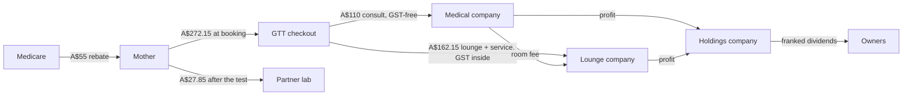
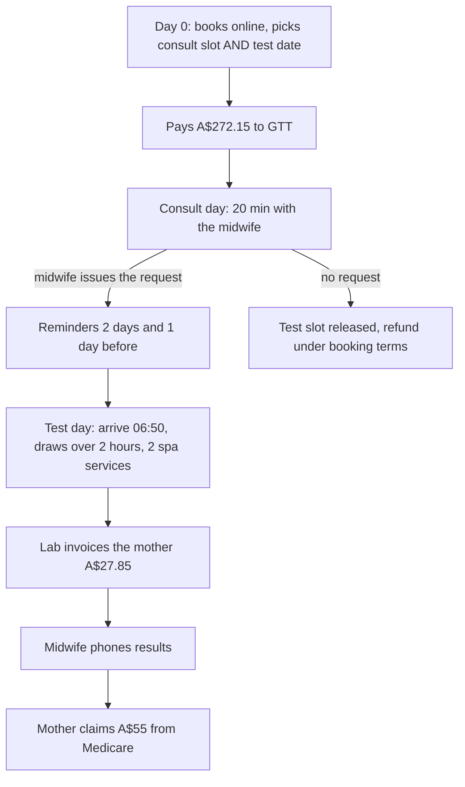
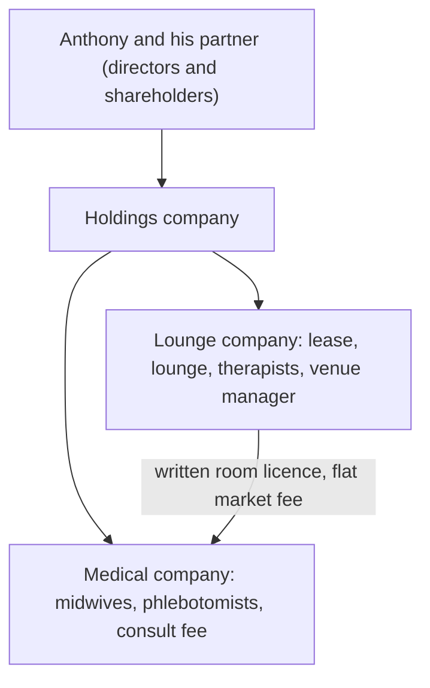
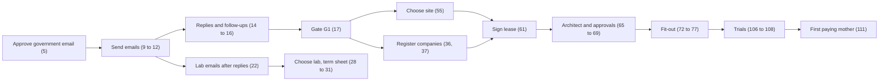

# Business Plan: GTT Center Perth (working title)

**A pregnancy glucose test, turned into a calm morning in a luxury day spa and maternal sanctuary.**

Prepared for: Anthony Zed, Founder and Private Healthcare Investor
Prepared by: business plan consultant, Round 19, 2026-10-25 (AWST)
Status: DRAFT for the founder. Nothing in this plan has been sent, signed, registered or paid.
Money: Australian dollars (A$). Monthly figures unless a line says otherwise.
Numbers: every figure comes from the repo, mainly [docs/FINANCIAL-CENTER-OF-TRUTH.md](../../FINANCIAL-CENTER-OF-TRUTH.md) (the Center of Truth) and [THEODORE-R19.md](THEODORE-R19.md). Appendix A lists each number with its source. Anything the repo does not hold is written as **NOT IN REPO**.

> **Important about the name.** "GTT Center Perth" is a working placeholder. There is no company, no ABN, no premises and no registered brand yet. Brand naming is on hold. The three companies described in this plan are described by their job ("the Holdings company", "the Medical company", "the Lounge company"), not by registered names.

---

## How to read this plan

| If you have... | Read this |
|---|---|
| 60 seconds | The "60 second version" just below |
| 5 minutes | Section 0 (the one-page summary and the money flowchart) |
| 20 minutes | Sections 0, 2, 6 and 8 |
| A meeting with a bank, landlord or lab | Sections 4, 5, 6, 7 and Appendix A |
| A question about a word | Section 10 (Glossary) |

**Three tags you will see:**

| Tag | Means |
|---|---|
| **Locked** | Anthony has decided it. It is not up for debate in this plan |
| **Modelled** | Worked out by the repo's own calculators (Theodore R19). Not yet proven by real trading |
| **NOT IN REPO** | The repo does not hold this number. Someone must find it. No guess is used |

**Two profit words, never mixed:** "before company tax" and "after company tax". The profit the owners can take home as dividends is the **after** number.

---

## The 60 second version

1. Almost every pregnant woman in Australia is asked to do a glucose tolerance test (GTT). She fasts overnight, drinks a sugary drink, and gives three blood samples over about two hours.
2. At a normal collection centre she sits on a plastic chair for two hours, hungry. We think that is a poor experience for something so common (a view, not a measured fact).
3. We turn those two hours into a calm morning: a midwife consult a few days before, then on test day a luxury lounge, and two 30-minute pampering services fitted between the blood draws.
4. The mother pays A$300 for Package 1 (A$350 for Package 2). She claims A$55 back from Medicare. Her own cost is A$245 (A$295 for Package 2), and that already includes the lab's A$27.85.
5. At today's locked prices the business is modelled to make **A$12,985.73 a month after company tax**. The founder's **goal is A$35,186 a month after company tax**. We are not there yet.
6. The honest path: a small price rise (+A$20) gets to A$19,327.05. Selling more Package 2 upgrades, small extras and a trimmed midwife roster close more of the gap. Reaching the full goal needs prices mothers may not accept, so we test demand before we commit.
7. Nothing is signed. The first step is free: emails to the government bodies, then to the labs.

---

## 0. Cover summary: explain it to a 16 year old

### What is this business, in one breath?

A place in Perth where a pregnant woman does her compulsory sugar-drink blood test in comfort, with a midwife, a lounge and two spa services, instead of a waiting room.

Think of it like an airport lounge for a test you have to take anyway. The flight (the test) is the same. The wait is completely different.

### Six key numbers

| # | Number | What it means | Status |
|---|---|---|---|
| 1 | **A$300** | Price of Package 1 (GST inside). Package 2 is A$350 | Locked |
| 2 | **A$245** | What the mother is really out of pocket after Medicare pays her A$55 back (lab fee included) | Modelled from official fees |
| 3 | **18** | Mothers a morning, Monday to Saturday (about 474 a month) | Locked |
| 4 | **A$272.15** | The part of each A$300 that reaches GTT (the rest, A$27.85, goes from the mother straight to the lab) | Modelled |
| 5 | **A$12,985.73** | Profit a month after company tax, at today's locked prices | Modelled |
| 6 | **A$35,186** | The founder's monthly goal, after company tax. Not yet reached | Goal |

### How the money moves

**Read the arrows like this:** the mother pays GTT once, at booking, for the consult and the lounge. She pays the lab separately, after the test, by the lab's own invoice. GTT never touches the lab's money. Medicare pays the mother back directly. Profit flows up to the Holdings company and then to the owners as dividends.

> **Summary box: Section 0**
> - Premium, pregnancy-only GTT experience, Perth.
> - A$300 package, A$245 real cost to the mother.
> - A$12,985.73 a month after tax today. A$35,186 is the goal, not the current number.

---

## 1. The problem and who we help

### 1.1 Who we help

Pregnant women in Perth who need the pregnancy glucose tolerance test (Medicare item 66548). GTT serves expecting mothers only. Anthony decided on 2026-10-20: "We will stick with pregnancy only for the whole clinic."

### 1.2 What the test actually involves

The GTT checks how a pregnant woman's body handles sugar. It is the screening test for gestational diabetes (diabetes that appears in pregnancy).

| Step | What happens to her |
|---|---|
| 1 | She fasts overnight. PathWest's patient instructions say fast 10 to 12 hours, no longer than 16 |
| 2 | First blood sample, fasting |
| 3 | She drinks a 75 g glucose drink (very sweet) |
| 4 | Second sample at 60 minutes |
| 5 | Third sample at 120 minutes |
| 6 | Only then can she eat |

Source: PathWest SOP-2484 as quoted in Catherine's library (R16, section 7), plus the repo's locked 60 and 120 minute timings. Water only from the start of the fast until the final draw.

### 1.3 Why it is unpleasant at a normal collection centre

What the repo holds as fact:

- PathWest's own instructions say the patient must "stay in the collection centre and remain seated until the test is finished". That is about two hours.
- She cannot eat, and may drink only water.
- She is pregnant, often tired, and sometimes feels sick after the glucose drink.

What the repo does **not** hold: a survey of how mothers feel about the test, waiting room conditions across Perth, or complaint data. Any claim that the normal experience is "awful" is the founder's view and our reading of the conditions above. It is **not measured** (gap: see section 9).

> **Analogy.** Imagine being told to skip breakfast, drink a can of syrup, then sit still in a corridor for two hours, while pregnant. Nothing about the test is wrong. The waiting is the problem we fix.

### 1.4 What she wants instead (our hypothesis)

| She wants | We offer |
|---|---|
| Not to be bored, hungry and uncomfortable | A luxury lounge and two spa services between draws |
| A clinician who explains the test | A 20-minute midwife consult before the test day |
| No surprise bills | All prices shown at booking, including the lab's fee |
| Clear results | The midwife phones her with results and refers on if needed |

> **Summary box: Section 1**
> - Customer: pregnant women in Perth needing item 66548.
> - The test is a two-hour fasting wait. The wait is the pain point.
> - The feeling-level evidence is not yet measured.

---

## 2. The service

### 2.1 The two packages

| | Package 1 | Package 2 |
|---|---|---|
| Price (GST inside) | **A$300** | **A$350** |
| Spa services | 2 services of 30 minutes | 2 services of up to 45 minutes (1 x 30 + 1 x 45, 2 x 30, or 2 x 45) |
| Midwife consult (20 minutes) | Included | Included |
| Lounge access and approved drinks during the draw | Included | Included |
| Blood test and collection | Billed by the lab, A$27.85 | Billed by the lab, A$27.85 |
| Mother's cost after Medicare | **A$245** | **A$295** |

Services fit between draws and never interrupt a draw. Draws happen at fixed times. Planning assumes **100% of mothers take Package 1** (the safe, lower number).

**Services offered in the morning** (from the repo's 8 morning staff): massage, beauty treatments, nails and hair.

**Food and drink rule (locked line):** "Water only until your last blood test. Your herbal tea and breakfast are waiting for you." Herbal tea only after the phlebotomist confirms the last draw is done. No free food: anything else is pre-purchased or bought at the counter.

### 2.2 The journey: 1 to 28 days, step by step

The midwife consult happens **1 to 28 days BEFORE the test**, on a different day. The consult produces the referral (the pathology request). No consult, no test. (Founder Rule, 2026-10-26.)

| # | When | What happens | Money |
|---|---|---|---|
| 1 | Day 0, online | She picks Package 1 or 2, a consult slot and a test date in one booking. The system only offers test dates 1 to 28 days after the consult | none yet |
| 2 | Day 0 | Details, due date, Medicare details as needed, booking terms, privacy notice | none |
| 3 | Day 0 | One checkout for GTT's part only | A$272.15 (Package 1): A$110 to Medical, A$162.15 to Lounge |
| 4 | Day 0 | Confirmation shows both appointments, the lab fee note and the fasting rule | none |
| 5 | Consult day | Short visit for the consult only. The venue manager welcomes her | none |
| 6 | Consult day | 20-minute clinical assessment. If the midwife decides the test is needed, she writes the pathology request and marks "request issued" | none at the desk |
| 7 | Between | Reminders 2 days and 1 day before: fasting, arrive 06:50 | none |
| 8 | Test day | Venue manager checks the "request issued" flag. No request on file means no draw | none |
| 9 | Test day | Phlebotomists collect three samples. Therapists give two services between draws | already paid |
| 10 | Test day | Samples go to the partner lab | none |
| 11 | After | The lab invoices her directly | A$27.85, mother to lab |
| 12 | After | The lab sends results to the midwife. The midwife phones her | none |
| 13 | After | She claims Medicare once she has paid each account | A$55 back to her |

Source: [WORKFLOW-LOCKED-R19.md](WORKFLOW-LOCKED-R19.md).

**Why the consult comes first:** the request has to exist before the blood is taken. A midwife who starts at 09:00 cannot write a request for a 07:00 draw on the same morning. Moving the consult to an earlier day solves that and lets the one consult room run at its own pace.

### 2.3 The lounge

The design brief, in words only (the architect draws; agents never draw floor plans):

- **Feel:** a luxury day spa and maternal sanctuary. Not clinical, not a hospital.
- **Rooms:** two collection rooms with one chair each, one consult room the same size as a collection room, an open luxury lounge, partitioned massage and beauty bays, a refreshment counter.
- **Footprint:** the repo's planning footprint is 239 to 249 square metres. The founder's architect brief spec says 257 to 290 square metres. These two ranges are not yet reconciled (gap for the architect).

> **Summary box: Section 2**
> - Two packages, A$300 and A$350, GST inside. Plan on Package 1.
> - Consult 1 to 28 days before the test. No consult, no test.
> - Lounge brief: day spa, not clinic. Architect only.

---

## 3. Why it can work and why us

### 3.1 The market, from repo facts only

| Fact | Value | Source and strength |
|---|---|---|
| Births in Greater Perth, 2024 | about 26,790 a year | KPMG analysis of ABS Births 2024, cited in CURRENT-STATE (ABS figures preliminary) |
| GTT tests in Perth metro | about 515 a week | Same source, assumes every pregnant woman is screened |
| GTT capacity at 18 a day, 6 days | 108 tests a week | Locked model |
| Share of the market we would need | about 21% | 108 / 515, repo arithmetic |

So the plan needs about one in five Perth mothers who do the test. That is a big share for a premium, paid service. It is the plan's single biggest demand question (see section 8).

### 3.2 Competitors

The repo's desk research (June 2026) found one direct competitor offering a GTT plus spa model: MIWM in Melbourne, which runs one client at a time, says it books 3 to 4 weeks ahead, and is in Victoria only. The repo found no Perth competitor doing this. **This research is four months old and has not been re-checked.** Mark it as unverified until Reed refreshes it.

### 3.3 Why us (the advantages the model is built on)

| Advantage | Why it matters |
|---|---|
| Two mothers start every 25 minutes, 18 a morning | More mothers through the same staff, so the price can stay closer to what mothers accept |
| Midwife-led | A real clinical consult and a proper results call, not just a blood draw |
| One clean booking | Consult, test date and lounge chosen at once, all prices shown up front |
| Pregnancy only | Clear identity. Catherine rates a pregnancy-only lounge as low discrimination risk if every pregnant person can book |
| Own staff | GTT employs its own midwives and phlebotomists, and runs the venue on its own terms |

### 3.4 Honest gaps in the market case

1. No survey of Perth mothers on willingness to pay. Theodore notes the founder's view that mothers accept A$245 out of pocket; no data tests A$265 or higher.
2. No Perth market price for a private 20-minute midwife consult.
3. Package 2 and extras take-up rates are illustrations, not demand data.
4. The GP referral survey (roadmap step 101) and the waitlist test (step 103) have not started. The plan needs at least 36 waitlist names before trial mornings (step 105).

> **Summary box: Section 3**
> - About 515 GTTs a week in Perth. We need about 21% of them.
> - One known competitor, in Melbourne. Research needs a refresh.
> - Willingness to pay is the big unknown.

---

## 4. How it is run

### 4.1 The team

| Role | How many | Hours | Employed by |
|---|---|---|---|
| Venue manager | 1 | Monday to Friday 06:30 to 15:00 | Lounge |
| Saturday lead | an experienced staff member already rostered | Saturday | Lounge |
| Morning service staff | 8 (4 massage and beauty, 2 nails, 2 hair) | 07:00 to 13:00 | Lounge |
| Phlebotomists (blood collectors) | 2 on mornings with 10 to 18 booked, 1 on mornings with 9 or fewer, none in the afternoon | mornings | Medical |
| Afternoon service staff | 4 casuals, 3-hour minimum shift | afternoons | Lounge |
| Midwives | 2 permanent part-time, 22.5 paid hours a week each, plus 1 casual for leave | 09:00 to 17:00 | Medical |

There is no separate front-desk role. The venue manager does welcome and reception.

**Why the phlebotomists and midwives sit in the Medical company:** Medicare allows collection by "another employee of that medical entrepreneur" (the same company that employs the requesting midwife). So collectors must be Medical employees, never Lounge staff and never contractors (Catherine R16).

### 4.2 Adaptive rostering, in plain words

Staff are called in to match the bookings. Nobody is rostered to stand around.

| Mothers booked that morning | Phlebotomists | Therapists |
|---|---|---|
| 1 | 1 | 2 |
| 2 to 9 | 1 | 4 |
| 10 | 2 | 6 |
| 11 to 18 | 2 | 8 |

A named second collector is on call for mornings of 9 or fewer.

### 4.3 The midwife roster: a fortnightly block

One midwife works Monday to Wednesday, the other Thursday to Saturday, for two weeks. Then they swap. That shares the Saturday pay fairly. (An option to swap Wednesday for Saturday will be discussed with the midwives at hiring.)

| Week | Monday to Wednesday | Thursday to Saturday |
|---|---|---|
| Weeks 1 and 2 | First midwife | Second midwife |
| Weeks 3 and 4 | Second midwife | First midwife |

**Does the consult room fit?** 18 consults a day x 20 minutes = 6 hours. The midwife is paid 7.5 hours a day, so she is 80% booked, with about 90 minutes for notes, calls and results letters. At 25 minutes a slot (20 minutes plus 5 for notes and turnover) the day fits exactly 18, with zero spare slots. Turnover time is not in the repo; 5 minutes is a test value only.

### 4.4 The partner lab

One lab, for a 3-year term matched to the lease. The lab tests the samples and supplies permitted collection items (tubes, needles, glucose drinks and so on). Our midwives run the test. The contract is written as non-exclusive with no volume promise, and GTT receives nothing of value for sending requests. Four labs will be approached together: PathWest, Western Diagnostic Pathology (WDP), Saturn Pathology and Australian Clinical Labs (ACL). Government bodies are emailed first; the labs only after the government replies.

**How the lab gets paid (recommended option):** the lab invoices the mother itself after it has the request and samples, by text link or invoice. WDP, ACL and PathWest already bill patients this way for samples collected by someone else. GTT pays A$0 card fees on the lab's fee and never holds it.

### 4.5 A typical Tuesday

| Time | What is happening |
|---|---|
| 06:30 | Venue manager unlocks, checks the day's bookings and the "request issued" flags |
| 06:50 | First two mothers arrive, fasted. No wiggle room for late arrivals |
| 07:00 | First pair: fasting draw in the two collection rooms, then the glucose drink |
| 07:00 to 13:00 | Therapists start the morning shift. Each mother gets two 30-minute services between her draws, done in ways the partner lab approves |
| 07:25, 07:50, ... | A new pair starts every 25 minutes |
| 08:00 | First pair's 60-minute draw |
| 09:00 | The Monday-to-Wednesday midwife arrives and starts consults for mothers testing in the next 1 to 28 days |
| 10:20 | Ninth and last pair's first draw (18 mothers in total) |
| 12:20 | Last 120-minute draw. Last mothers get herbal tea and breakfast |
| 13:00 | Morning therapists finish |
| Afternoon | Four casual staff run pre-booked standalone services. A senior staff member covers after the venue manager leaves at 15:00 |
| 17:00 | Midwife finishes consults and results calls |
| 18:00 | Doors shut. All services finished |

**Known gap: no clinician on site from 07:00 to 09:00.** Medicare law does not require the midwife to be in the room for her employer's collectors (Catherine's strong reading), and Anthony accepted the 09:00 start. But a mother could faint or vomit after the glucose drink. The partner lab's manual sets what clinical cover is needed; that is an open question for the lab.

**Known conflict to solve with the lab:** PathWest's instructions say "remain seated until the test is finished". Our model has spa services between draws. Catherine's route: seated treatments (recliner-based), with the partner lab approving in writing which treatments are allowed.

> **Summary box: Section 4**
> - 8 morning therapists, up to 2 phlebotomists, 4 afternoon casuals, a venue manager, 2 part-time midwives.
> - Rosters follow bookings. Midwives swap blocks every fortnight.
> - One lab, 3 years. Lab bills the mother itself.

---

## 5. The rules we follow

This section summarises what Catherine (legal consultant) has concluded in her library. It is not legal advice. A solicitor, an accountant and an insurance broker must check before anything is signed.

### 5.1 Medicare, in plain words

| Rule | Plain meaning | Source (Catherine's library) |
|---|---|---|
| A participating midwife can request item 66548 | Our midwife can write the GTT referral | HIA s 16A(1)(aa); Regulations s 30 |
| The request must exist before collection | Consult first, test later | Catherine R16 section 5; Regulations s 35 |
| Collectors must be employees of the midwife's employer | Phlebotomists sit in the Medical company | HIA s 16A(5AA)(c)(iv) |
| Each midwife needs her own provider number for the venue | Apply once she is hired; can take up to 28 days | Catherine R16 |
| No kickbacks between lab and requester | GTT takes nothing of value from the lab for sending requests; only listed free supplies | HIA Part IIBA, s 23DZZIF; Permitted Benefits Determination 2018 |
| The consult fee covers the consult only | No lounge value hidden in the consult price; the room cost is not a separate charge on the consult account | Services Australia rule cited in R18; MBS note MN.13.10 |
| Genuine clinical care, records kept | No pay or target linked to requests; notes for every woman | HIA s 82 (Professional Services Review) |
| Accurate collection notice in each room | Locked wording W3 explains who collects and who bills | HIA s 23DNL (GTT will ask the Department to confirm) |

**Structure B, simply:** GTT charges a private, all-inclusive price. The mother claims her own Medicare rebate. Medicare pays her: A$32.95 for the consult, A$16.95 for the test and A$5.10 for collection, A$55 in total.

### 5.2 What the lab must do

Follow its own collection manual (tubes, labels, courier). Confirm in writing any glucose drink GTT supplies. Release results to the requesting midwife and phone urgent results the same day. Bill the mother itself. Sign off our collection room design.

### 5.3 What the midwife must do

Hold Ahpra registration and professional indemnity insurance (National Law s 129). Assess each woman genuinely and record why she requested or did not request. Follow the positive-result pathway (locked W11): review results, phone the woman, refer to her GP, obstetrician or hospital service, write a result letter, and audit every positive result monthly. Results consults are billed separately, never inside the package.

### 5.4 Privacy, workers compensation, safety and Fair Work

| Area | What applies | Status |
|---|---|---|
| Privacy | The Privacy Act 1988 applies to every health service provider, whatever its size (s 6D(4)(b)): privacy policy, collection notice, security, data breach notification | Established |
| Workers compensation | Compulsory in WA for each employing company. Penalty up to A$10,000 per worker for not insuring | Established (WorkCover WA Information Sheet 41) |
| Work health and safety | Safe workplace, first aid, needlestick procedure (WHS Act 2020 (WA) s 19) | Established |
| Fair Work awards | Award classes and rates for midwives, phlebotomists, therapists and the 06:30 start are **not confirmed**. A Fair Work Infoline call is planned (roadmap steps 19 and 20) | Open |
| WA health facility licence | A consult room plus collection rooms is probably not a licensable private hospital (no overnight stay, no anaesthetic). GTT will ask WA Health for a written view | Strong reading, not confirmed |
| Accessibility | Disability Discrimination Act s 23 and the premises standards apply to the fit-out | Building surveyor to check |
| Advertising | No misleading claims and no testimonials when promoting the midwife (National Law s 133) | Established |
| Sex discrimination | Pregnancy-only lounge is low risk if every pregnant person can book | Catherine, round 9 |

### 5.5 Open legal questions

1. Is there a legal maximum gap between the request date and the collection date? The booking system uses Anthony's 28 days (Catherine, C1).
2. Does GTT need written consent to pass booking details to the lab, and with what wording (Catherine, C-a)?
3. Would a lab payment terminal or lab payment link count as a benefit under the anti-kickback rules (Catherine, C-b)?
4. Will the Department confirm in writing that the s 23DNL "no Medicare benefit" notice does not apply?
5. Which collection item applies, 73928 or 73938 (AskMBS)?
6. If a mother has claimed her rebate and GTT later refunds the consult, what must happen (Catherine)?
7. Refund promise wording and the consumer guarantee text (lawyer).
8. What clinical cover the partner lab requires from 07:00 to 09:00 (the lab).

> **Summary box: Section 5**
> - Midwife requests, Medical employees collect, mother claims her own rebate.
> - No kickbacks, accurate notices, real records.
> - Eight legal questions remain open and are listed above.

---

## 6. The money, in plain English

### 6.1 One mother's A$300, step by step (Package 1)

Think of the A$300 like a pizza cut into slices. Some slices go to other people before GTT eats.

| Step | A$ per mother | Who gets it |
|---|---|---|
| Mother's package price | **A$300.00** | |
| Lab fee, paid by the mother to the lab | -A$27.85 | The lab (never GTT money) |
| **Reaches GTT** (consult A$110 + lounge and service A$162.15) | **A$272.15** | Medical + Lounge |
| GST inside the lounge and service part | -A$14.74 | The ATO |
| Card fee on GTT's A$272.15 | -A$4.93 | The card provider |
| **GTT keeps from the package** | **A$252.48** | |
| Plus afternoon sales per morning mother (ex GST, after card fee) | +A$46.14 | |
| Less repo staff (8 morning service staff, 2 phlebotomists, 4 afternoon staff, venue manager base shift) | -A$197.48 | Wages |
| Less running costs (rent, insurance, overheads, supplies), after GST credits | -A$27.48 | |
| Less midwife wages | -A$25.32 | |
| Less midwife fixed costs and consumables | -A$5.99 | |
| Less venue manager's extra half hour (06:30 start) | -A$1.06 | |
| Less payroll tax | -A$2.84 | RevenueWA |
| Less three-company running cost | -A$1.92 | |
| **Profit per mother before company tax** | **A$36.53** | |
| Company tax 25% | -A$9.13 | The ATO |
| **Profit per mother after company tax** | **A$27.40** | Available as franked dividends |

Then Medicare pays the mother A$55, so **her own cost is A$245** (A$295 on Package 2), lab fee included.

### 6.2 The monthly profit and loss (whole venture, locked prices)

| Line | Monthly | Tag |
|---|---|---|
| Lounge and service, morning, ex GST (474 x A$147.41) | A$69,863.50 | Modelled |
| Afternoon sales, ex GST | A$22,350.34 | Repo |
| Consult, GST-free (474 x A$110) | A$52,133.40 | Modelled |
| **Revenue, ex GST** | **A$144,347.23** | |
| Repo staff (8 morning service, 2 phlebotomists, 4 afternoon, venue manager base shift), super, workers comp | -A$93,595.63 | Repo |
| Running costs (rent, insurance, overheads, supplies) | -A$14,288.34 | Repo |
| GST credits on costs | +A$1,262.58 | Repo |
| Card fees, morning | -A$2,336.52 | Estimate |
| Card fees, afternoon | -A$480.99 | Estimate |
| Midwife wages (45 hours a week, casual leave cover inside) | -A$12,000.38 | Estimate |
| Midwife fixed costs and consumables (one consult room) | -A$2,840.65 | Estimate |
| Venue manager 06:30 start | -A$500.28 | Repo rate |
| WA payroll tax, whole group | -A$1,344.04 | Estimate |
| Three-company running cost | -A$908.67 | Estimate |
| **Profit before company tax** | **A$17,314.31** | |
| Company tax 25% | -A$4,328.58 | Estimate |
| **Profit after company tax (franked dividend available)** | **A$12,985.73** | |

Rent inside running costs is the repo's A$8,000 a month budget, kept by Anthony's decision until a real lease is on the table.

### 6.3 Where the old A$35,186 figure went

The repo's older headline was A$35,186.40 a month. It was always **before** company tax, and it left out several real costs. Theodore R19 rebuilt it line by line:

| Step | Change | Running total |
|---|---|---|
| Old repo headline | | A$35,186.40 |
| GST the old model counted as income | -A$11,743.82 | A$23,442.58 |
| Card fees, morning (old price) | -A$2,156.43 | A$21,286.15 |
| Card fees, afternoon | -A$480.99 | A$20,805.16 |
| Payroll tax on the old wages | -A$562.45 | A$20,242.71 |
| Three-company running cost | -A$908.67 | **A$19,334.04** (honest old plan) |
| Consult income added | +A$52,133.40 | |
| Lounge line now smaller (part of the price is now the consult) | -A$37,850.14 | |
| Extra card fee | -A$180.09 | |
| Midwife wages | -A$12,000.38 | |
| Midwife fixed costs and consumables | -A$2,840.65 | |
| Venue manager 06:30 | -A$500.28 | |
| Extra payroll tax | -A$781.59 | **A$17,314.31** (today, before tax) |
| Company tax | -A$4,328.58 | **A$12,985.73** (today, after tax) |

**Plain reading:** most of the "drop" was never real money. The new decisions (adding the midwife, the package split, the 06:30 start) cost only about A$2,020 a month. The midwife herself earns far more than she costs: the consult brings in A$110 a mother and the midwife side shows a surplus of about A$35,656 a month.

### 6.4 GST, explained for a teenager

GST is a 10% tax on most things sold in Australia. The business collects it for the government and hands it over. It is never the business's money.

| Part of the package | GST? | Why |
|---|---|---|
| Midwife consult (A$110) | No (GST-free) | Health service |
| Lounge and spa services (A$162.15) | Yes, 1/11 of the price is GST (A$14.74) | Like any spa |
| Lab fee (A$27.85) | Not GTT's sale | Paid to the lab |

Each month GTT passes about A$6,985.88 (morning) and A$2,235.03 (afternoon) in GST to the ATO. In year 1 the three companies form a **GST group**, so charges between them (like the room fee) do not create GST paperwork inside the group.

**One caution:** when one checkout sells a GST-free consult and a taxable lounge together, the split must have a reasonable basis (ATO ruling GSTR 2001/8). Medical should charge the same consult fee to every patient, package or not. The accountant must confirm.

### 6.5 Payroll tax, company tax and dividends

| Tax | Simple meaning | In our numbers |
|---|---|---|
| Payroll tax (WA) | A state tax on wages above a threshold. 5.5% above the A$1m grouped threshold, with a tapering deduction. All three companies share one threshold | A$1,344.04 a month (estimate, check with RevenueWA). Anthony accepts this cost |
| Company tax | 25% for a base rate entity. With tax consolidation in year 1, the three companies file one return | A$4,328.58 a month |
| Dividends | Profit after company tax paid to the owners. "Franked" means the company tax already paid comes with the dividend as a credit | A$12,985.73 a month available |

**Order of payments to the owners:** the owners' start-up money goes in as written shareholder loans and is repaid before dividends (Decision Log, 2026-10-19). Holdings never lends money to the shareholders (Division 7A rule). The owners take no wage; they receive profit as dividends.

### 6.6 Break-even

| Question | Answer |
|---|---|
| Break-even mothers a day on today's locked basis | **NOT IN REPO.** The last figure (7.25 a day) was worked out on the old price without the midwife, and must be re-run by Theodore |
| Price needed to match the honest old plan (A$19,334.04 before tax) | About A$304.34 to A$304.79 for Package 1, about A$4.50 more than today |

Plain reading: at 18 mothers a day the business makes a profit, but we do not yet know how few mothers a day it can survive on with the midwife added. That re-run is item 1 for Theodore in section 9.

### 6.7 Sensitivity: what moves the profit

| Change | Effect a month, before company tax | Effect a month, after company tax | Tag |
|---|---|---|---|
| Lounge and service +A$10 | +A$4,227.54 | +A$3,170.66 | Modelled |
| Lounge and service +A$20 | +A$8,455.09 | +A$6,341.32 | Modelled |
| Consult +A$10 | +A$4,658.83 | +A$3,494.12 | Modelled |
| Consult +A$20 | +A$9,317.66 | +A$6,988.25 | Modelled |
| 10% of mothers choose Package 2 | +A$2,113.77 | +A$1,585.33 | Take-up is illustrative |
| 30% choose Package 2 | +A$6,341.32 | +A$4,755.99 | Take-up is illustrative |
| 50% choose Package 2 | +A$10,568.86 | +A$7,926.65 | Take-up is illustrative |
| 10% buy a massage upgrade (30 to 45 minutes, A$45) | +A$1,902.59 | +A$1,426.94 | Take-up is illustrative |
| Midwife paid hours 45 to 42 a week | +A$850.04 | +A$637.53 | Needs Anthony's approval |
| Midwife paid hours 45 to 39 | +A$1,700.09 | +A$1,275.07 | Needs Anthony's approval |
| Midwife on-cost 1.20 instead of 1.366 | +A$1,575.44 | | Sensitivity only |
| 10% post-test discount, 25% take-up | -A$1,386.27 | | Adopted, not yet in the headline |

**Rule of thumb:** every A$1 added to lounge and service adds about A$422.75 a month before tax. Every A$1 added to the consult adds about A$465.88.

**Volume sensitivity** (profit if only 12 or 15 mothers a day come) on today's basis: **NOT IN REPO**. Theodore to run.

### 6.8 The path from today's number to the A$35k goal

**The goal:** A$35,186 a month **after** company tax. That needs about A$46,915.20 before company tax.
**Today:** A$12,985.73 after company tax.
**The gap:** about A$22,200 a month after tax.

| Step | What changes | Mother's cost (P1 / P2) | Profit after company tax | Still short of goal |
|---|---|---|---|---|
| Today | Locked prices A$300 / A$350 | A$245 / A$295 | A$12,985.73 | about A$22,200 |
| 1. Recommended | +A$20 on lounge and service (A$320 / A$370) | A$265 / A$315 | **A$19,327.05** | about A$15,859 |
| 2. | Step 1 + midwife hours to 42 | A$265 / A$315 | A$19,964.58 | about A$15,221 |
| 3. | Step 2 + 30% of mothers on Package 2 | A$265 / A$315 | A$24,721.64 | about A$10,464 |
| 4. | Consult +A$20, 39 hours, 50% on Package 2 | A$265 / A$315 | A$29,175.69 | about A$6,010 |
| 5. | Consult +A$30, 42 hours, 50% on Package 2 | A$275 / A$325 | A$32,032.28 | about A$3,154 |
| Price only | +A$70 on lounge and service | A$315 / A$365 | A$35,183.90 | about A$2 |

**What this table honestly says:**

1. Today's modelled number is A$12,985.73 after tax. The A$35k is a **goal**, not a result.
2. Even the most hopeful mix of levers (step 5) assumes half of all mothers buy the dearer package, and still falls about A$3,154 short.
3. Price alone reaches the goal only if mothers pay about A$315 out of pocket on Package 1, A$70 more than the A$245 the founder believes they accept. On the 100% Package 1 plan, Theodore's verdict is that the goal is **not reachable at prices we know mothers accept**.
4. The afternoon is not a lever today: Anthony locked it at 10 sessions a weekday and 5 on Saturday. Growing it means re-opening that decision.

**What we recommend:**

1. Approve +A$20 on lounge and service (A$320 / A$370). Profit becomes A$19,327.05 after tax.
2. Sell Package 2 as the natural upgrade. Each 10% who take it adds about A$1,585 after tax.
3. Test demand before opening: the waitlist and GP survey must show whether mothers accept A$265 or more. If they do, price rises in A$10 steps are the strongest lever.
4. Decide whether the 10% post-test discount belongs in the headline (it costs about A$1,386 a month before tax).
5. Report progress against the A$35,186 goal every month once open, using the Center of Truth.

### 6.9 Start-up money

| Item | Low | High | Status |
|---|---|---|---|
| Fit-out and construction (239 sqm at A$800 to A$1,250 a sqm) | A$191,200 | A$298,750 | Modelled, needs builder quotes |
| Equipment, furniture, signage | A$61,190 | A$140,430 | Modelled |
| Working capital reserve | A$85,000 | A$110,000 | Modelled |
| Register three companies (3 x A$636) | A$1,908 | A$1,908 | Fee |
| Lease bond (about 2 months rent at A$8,000) | about A$16,000 | about A$16,000 | Modelled |
| **Current planning figure (approved in principle, 2026-08-10)** | **251,198 Australian dollars** | | Planning only, before the midwife and the new prices |

Funding: the owners' own savings, about A$200,000 per the repo's standing facts. No outside investor. **The planning figure is higher than the savings figure, and both were set before the midwife model.** A fresh start-up cost and cash-flow re-run on the R19 basis is **NOT IN REPO** and is a priority for Theodore.

> **Summary box: Section 6**
> - A$300 becomes A$27.40 profit per mother after tax.
> - A$12,985.73 a month after tax today. Recommended +A$20 gives A$19,327.05.
> - A$35,186 after tax is the goal. Reaching it needs higher prices or a big Package 2 share, both unproven.

---

## 7. Setting it up

### 7.1 The company structure, drawn simply

| Company | Job | Why separate |
|---|---|---|
| Holdings | Owns the other two. Receives their profits. Can own the brand later | Keeps retained profit away from claims against the operating companies |
| Medical | Employs the midwives and phlebotomists, bills the consult | Medicare's collection rule needs collectors employed with the midwife; keeps clinical risk in one place |
| Lounge | Holds the lease, sells the lounge and services, employs therapists and the venue manager | The lease is the biggest liability, so it is ring-fenced |

In year 1 the three elect **tax consolidation** (one income tax return) and a **GST group**. The Lounge company grants the Medical company a written licence to use the consult and collection rooms, at a flat market fee, never linked to Medicare benefits or requests. Inside the group the room fee has no profit effect. A second venue later would get its own Lounge-type company and reuse the Medical company (Catherine R16).

### 7.2 The roadmap: 13 phases, 116 steps

Week ranges are estimates, not promises. Phases can overlap. Only each step's "needs step N first" tag sets the order.

| Phase | Name | Weeks (estimate) | Steps | Key outcome |
|---|---|---|---|---|
| 0 | Decisions and holds | 1 to 2 | 1 to 8 (8) | Roster approved, government email text approved, PRODA account |
| 1 | Government and agency introductions | 1 to 12 | 9 to 20 (12) | Department, AskMBS, WA Health emailed; Services Australia letter; Gate G1 review; Fair Work call |
| 2 | Lab selection and 3-year term sheet | 2 to 20 | 21 to 32 (12) | Four labs approached after government replies; one lab chosen; term sheet signed |
| 3 | Entities, accountant, consolidation | 1 to 12 | 33 to 46 (14) | Accountant engaged; three companies registered; ABNs, GST group, consolidation, payroll tax |
| 4 | Insurance broker, bank, payments | 8 to 16 | 47 to 52 (6) | Six insurance quotes; payment design signed off |
| 5 | Premises and 3-year lease | 6 to 28 | 53 to 62 (10) | Site found, lease reviewed and signed, bond paid |
| 6 | Architect, design, approvals | 16 to 34 | 63 to 71 (9) | Words-only brief; registered architect; council and building approvals |
| 7 | Fit-out and equipment | 32 to 48 | 72 to 77 (6) | Builder contract; equipment; lab signs off rooms |
| 8 | People | 24 to 46 | 78 to 86 (9) | Midwives, venue manager, phlebotomists, therapists hired and trained |
| 9 | Provider numbers, booking system, policies | 28 to 46 | 87 to 94 (8) | Provider numbers; booking system tested; policy pack; website approved |
| 10 | Operations manual and test morning | 22 to 46 | 95 to 100 (6) | Manual rewritten; positive-result pathway; test-morning procedure approved |
| 11 | Demand: GP outreach and waitlist | 10 to 50 | 101 to 105 (5) | GP survey; waitlist of at least 36 names |
| 12 | Trial mornings and launch | 46 to 52 | 106 to 111 (6) | Dry run, three clean trial mornings, first paying mother |
| Added in Round 18 | Model review and follow-ups | any time | 112 to 116 (5) | Model copied after approval; refund answer; AskMBS item question |

Total: 116 steps. 2 were done at the time of writing; steps 114 and 115 (consult timing) are effectively answered by the 2026-10-26 Founder Rule. Source: [EXECUTION-ROADMAP-TICKLIST.md](../L13-r18/EXECUTION-ROADMAP-TICKLIST.md).

### 7.3 The critical path (the chain that sets the opening date)

**Gate G1 (step 17)** is the big safety rule: no company registration, lease or hiring until the government answers are good enough and Anthony says go.

### 7.4 The first 8 things to do now (all free, no company needed)

| # | Step | What | Who |
|---|---|---|---|
| 1 | 5 | Approve the one universal government introduction email and its recipients | Anthony |
| 2 | 9, 10, 12, 11 | Email the Department's pathology team, AskMBS and WA Health licensing. Post the same text to Services Australia Pathology Approvals (it publishes no email inbox) | Anthony sends; Grace drafts |
| 3 | 3 | Give the final yes on the three-company structure | Anthony |
| 4 | 112 | Decide on Theodore's R19 recommendation (+A$20) and approve copying the Center of Truth numbers into the master model | Anthony |
| 5 | 1 | Approve the fortnightly midwife block (or the Wednesday and Saturday swap) | Anthony |
| 6 | 21 | Build the four-lab comparison (PathWest, WDP, Saturn, ACL) so lab emails go out the day government replies land | Reed |
| 7 | 19 | Draft the Fair Work Infoline question list for all awards and the 06:30 start | Catherine |
| 8 | 6 | Set up a personal PRODA account (free, identity documents only) | Anthony |

> **Summary box: Section 7**
> - Holdings owns Medical and Lounge. One tax return, one GST group in year 1.
> - 116 steps over about a year (estimate). Government first, then labs.
> - Eight free steps can start today.

---

## 8. Risks and how we handle them

Ratings are the consultant's judgement from the repo evidence (Low, Medium, High).

| # | Risk | How likely | How bad | What we do |
|---|---|---|---|---|
| 1 | **Lab agreement.** No lab agrees to our model, or a lab wants to run the rooms | Medium | High | Approach all four labs at once with fresh contacts; written questions first; non-exclusive 3-year term sheet; keep a dormant standby agreement with a second lab |
| 2 | **Medicare rule change or ruling.** The Department reads s 23DNL, s 16A or the request rules differently | Medium | High | Email the Department and AskMBS first, before spending money (Gate G1); exit trigger in the lab contract; fallback is a lab-run room |
| 3 | **Midwife hiring.** Cannot find two endorsed midwives, or provider numbers are slow | Medium | High | Start recruiting once companies exist; check the Ahpra register; flat pay, no targets; a casual for leave; apply for provider numbers early (up to 28 days) |
| 4 | **No-shows and late arrivals** | Medium | Medium | Arrive by 06:50, no wiggle room; reminders 2 days and 1 day before; test slot released at 18:00 the day before if the consult is missed; refund rules in the booking terms (still to be decided) |
| 5 | **Price acceptance.** Mothers will not pay A$265 or more out of pocket | High | High | Waitlist and GP survey before opening; small A$10 steps; Package 2 as an upgrade, not a push |
| 6 | **Pregnancy-only demand.** We need about 21% of Perth's GTTs; the market is capped by the number of births | Medium | High | Pre-launch waitlist of at least 36 names; GP, midwife and obstetrician outreach; marketing promotes the midwife and seamless care |
| 7 | **Payment and booking software.** Cannot enforce two linked slots, the 1 to 28 day gap and the "request issued" flag | Medium | High | Test booking and payment before launch (step 89); hard rules written in [WORKFLOW-LOCKED-R19.md](WORKFLOW-LOCKED-R19.md) section 5; card provider not yet chosen |
| 8 | **Consult room full.** 18 slots a day with zero spare at 25 minutes each | Medium | Medium | Sell 18 slots and keep 20-minute gaps for same-week rebookings; telehealth consult is an option in the library, not decided |
| 9 | **No clinician on site 07:00 to 09:00.** A mother faints or vomits | Low | High | First-aid trained collectors; emergency kit; lab's manual decides clinical cover; escalation procedure signed by the clinical lead midwife |
| 10 | **Seated rule versus spa services.** The lab requires mothers to remain seated | Medium | High | Recliner-based seated treatments; lab approves the treatment list in writing |
| 11 | **Start-up money.** Costs exceed savings; the planning figure predates the midwife | Medium | High | Re-run start-up costs and cash flow on R19; get real quotes; landlord contribution not assumed |
| 12 | **No venue yet.** Candidate sites from July were mostly leased or unverified | High | High | Fresh list of at least 5 sites (step 53); rent budget A$8,000 a month, revisited at lease stage |
| 13 | **Venue manager carries too much.** Safety duties sit with one person | Medium | High | Clear Saturday and afternoon senior cover once open; first aid for all staff |
| 14 | **Cost estimates are estimates.** Card fee, award rates, payroll tax and insurance are not quoted | High | Medium | Broker quotes (step 49), Fair Work call (step 20), accountant (step 33); refresh the Center of Truth after each |

> **Summary box: Section 8**
> - The two biggest risks are price acceptance and the lab agreement.
> - Government answers come before any money is spent.
> - Demand is tested with a waitlist before trial mornings.

---

## 9. What we still need to find out

| # | Question | Who answers |
|---|---|---|
| 1 | Re-run break-even mothers a day, start-up costs, cash flow and payback on the R19 basis | Theodore |
| 2 | Profit at 12 and 15 mothers a day (volume sensitivity) | Theodore |
| 3 | Casual midwife cost, and whether the A$15,000 a year relief pool covers it | Theodore, then Anthony |
| 4 | Which card provider, and its real fee (estimate is 1.7% + A$0.30) | Theodore |
| 5 | Interest rate on prepaid package money (GTT's own money only, never the lab's) | Theodore |
| 6 | Payroll tax confirmation with RevenueWA; GST split between consult and lounge | Theodore with the accountant |
| 7 | Request-to-collection time limit; privacy consent wording; lab payment link and the anti-kickback rules | Catherine |
| 8 | s 23DNL confirmation from the Department; refund after a rebate claim; refund promise wording | Catherine (and a lawyer) |
| 9 | Award classes and rates for every role, including the 06:30 start | Catherine drafts, Anthony calls Fair Work |
| 10 | Consult turnover and notes time per mother (5 minutes used only as a test) | Grace with the clinical lead |
| 11 | Booking system choice (the repo names Fresha; check with Anthony) and whether it can enforce the rules | Grace |
| 12 | Senior cover for afternoons and Saturdays, and any pay loading | Grace, once operating |
| 13 | Site list and the floor area range (239 to 249 versus 257 to 290 sqm) | Grace and the architect |
| 14 | Four-lab comparison; each lab's fee, billing option and seated rule | Reed |
| 15 | Perth market price for a private 20-minute midwife consult | Reed |
| 16 | Refresh the competitor check (MIWM and any Perth entrant) | Reed |
| 17 | Collection item 73928 or 73938 (changes the lab's price and rebate by A$1.70, not GTT's revenue) | AskMBS, via Grace's draft |
| 18 | Approve +A$20 on lounge and service, a smaller rise, or none | Anthony |
| 19 | Midwife paid hours: keep 45 or trim to 42 | Anthony |
| 20 | Put the 10% post-test discount into the headline profit, or keep it separate | Anthony |
| 21 | Refund rules if no request is issued or the consult is missed | Anthony |
| 22 | A mother who already holds a GP or obstetrician request: does she still book the consult? | Anthony |
| 23 | Final yes on three companies; Wednesday and Saturday swap option | Anthony |
| 24 | Booking page wording that shows the A$300 includes the lab's A$27.85, paid separately to the lab | Anthony approves Grace's draft |

---

## 10. Glossary

| # | Term | Plain meaning |
|---|---|---|
| 1 | GTT | Glucose tolerance test. Fasting blood test, sugar drink, then two more blood tests over two hours |
| 2 | Gestational diabetes | Diabetes that shows up during pregnancy. The GTT screens for it |
| 3 | Item 66548 | The Medicare number for the pregnancy GTT |
| 4 | Item 82105 | The Medicare number for our 20-minute midwife consult |
| 5 | Medicare rebate | Money Medicare pays back to the patient after she pays a bill |
| 6 | Out of pocket | What the mother really pays after her rebate |
| 7 | Structure B | Our model: one private price, and the mother claims her own rebate |
| 8 | Pathology request (referral) | The written order from the midwife that lets the lab do the test |
| 9 | Phlebotomist | A trained person who takes blood |
| 10 | Endorsed midwife | A midwife allowed to work under Medicare and request certain tests |
| 11 | Provider number | The Medicare number each clinician needs at each location |
| 12 | Ahpra | The body that registers health practitioners. Its public register shows who is registered |
| 13 | Partner lab | The pathology company that tests the samples |
| 14 | Anti-kickback rules (Part IIBA) | Laws stopping labs giving anything of value to people who send them tests |
| 15 | Collection notice | A sign that explains who takes the blood and who bills |
| 16 | GST | A 10% tax on most sales, collected for the government |
| 17 | GST-free | A sale with no GST on it, like a health consult |
| 18 | GST group | Related companies treated as one for GST, so charges between them create no GST |
| 19 | Ex GST | A price with the GST taken out |
| 20 | Company tax | Tax a company pays on its profit. 25% for a base rate entity |
| 21 | Base rate entity | A smaller company that pays the lower 25% company tax rate |
| 22 | Tax consolidation | A group of companies filing as one taxpayer |
| 23 | Dividend | Profit a company pays to its shareholders |
| 24 | Franked dividend | A dividend that carries a credit for company tax already paid |
| 25 | Shareholder loan | Money the owners lend the company, repaid before dividends |
| 26 | Payroll tax | A WA tax on total wages above a threshold |
| 27 | On-cost | Extra cost on top of wages (super, workers comp, leave) |
| 28 | Adaptive rostering | Rostering only the staff the day's bookings need |
| 29 | Break-even | The point where income exactly covers costs |
| 30 | Sensitivity | How much profit moves if one input changes |
| 31 | Gate G1 | The checkpoint before any company, lease or hiring commitment |
| 32 | Center of Truth | The one repo file holding every money number, regenerated by script |

---

## Appendix A: every number and its source

Main sources: **CoT** = [docs/FINANCIAL-CENTER-OF-TRUTH.md](../../FINANCIAL-CENTER-OF-TRUTH.md); **T19** = [THEODORE-R19.md](THEODORE-R19.md); **WF** = [WORKFLOW-LOCKED-R19.md](WORKFLOW-LOCKED-R19.md); **FI** = [FOUNDER-INTERVIEW-LOCKED.md](../L13-r18/FOUNDER-INTERVIEW-LOCKED.md); **RO** = [ROSTER-R18.md](../L13-r18/ROSTER-R18.md); **RM** = [EXECUTION-ROADMAP-TICKLIST.md](../L13-r18/EXECUTION-ROADMAP-TICKLIST.md); **CS** = [docs/CURRENT-STATE.md](../../CURRENT-STATE.md); **DL** = [docs/DECISION-LOG.md](../../DECISION-LOG.md); **LB** = [LAB-BILLING-WORKFLOW-R19.md](LAB-BILLING-WORKFLOW-R19.md); **CAT** = Catherine's library r16 (server).

| Number | Meaning | Source |
|---|---|---|
| A$300 / A$350 | Package prices, GST inside | FI 2, 3; CoT 1 |
| A$27.85 | Lab fee, paid by the mother to the lab | CoT 1 |
| A$110 | Consult fee, GST-free, item 82105 | CoT 1 |
| A$162.15 / A$212.15 | Lounge and service part, P1 / P2 | CoT 1 |
| A$272.15 / A$322.15 | Reaches GTT, GST inside | CoT 1 |
| A$257.41 / A$302.86 | Reaches GTT, ex GST | CoT 1 |
| A$32.95 + A$16.95 + A$5.10 = A$55 | Medicare rebate to the mother | CoT 1 |
| A$245 / A$295 | Mother's out of pocket | CoT 1 |
| 18 a day; 473.94 a month | Morning mothers | CoT 2 |
| 210.13 a month at A$117 | Afternoon transactions | CoT 2 |
| 10 weekday / 5 Saturday sessions | Afternoon lock | T19 T2 (f); CS 0 |
| 8 (4, 2, 2), 07:00 to 13:00 | Morning service staff | CoT 2 |
| 2 or 1 phlebotomists | Adaptive collectors | CoT 2; CS 00 |
| 4 casual, 3-hour floor | Afternoon staff | CoT 2 |
| 06:30 to 15:00 Mon to Fri | Venue manager | CoT 2; FI 14 |
| 2 x 22.5 h = 45 h a week, 09:00 | Midwives | CoT 2; RO |
| 36 h a week, 80% | Consult hours needed | CoT 2; WF 4 |
| 18 slots at 25 min, zero spare | Consult room fit | WF 4 |
| 1 consult room, 2 collection rooms | Rooms | CoT 2; FI 17, 19 |
| A$41.59 an hour, 150% Saturday | Midwife award rate estimate | CoT 3 |
| 1.366 (1.20 sensitivity) | Midwife on-cost | CoT 3 |
| 1.7% + A$0.30 | Card fee estimate | CoT 3 |
| 5.5% above A$1m | WA payroll tax | CoT 3 |
| 25% | Company tax | CoT 3 |
| A$69,863.50 | Morning lounge and service revenue ex GST | CoT 4 |
| A$22,350.34 | Afternoon revenue ex GST | CoT 4 |
| A$52,133.40 | Consult revenue | CoT 4 |
| A$144,347.23 | Revenue ex GST | CoT 4 |
| A$93,595.63 | Repo staff cost | CoT 4 |
| A$14,288.34 | Running costs | CoT 4 |
| A$1,262.58 | GST credits | CoT 4 |
| A$2,336.52 / A$480.99 | Card fees morning / afternoon | CoT 4 |
| A$12,000.38 | Midwife wages | CoT 4 |
| A$2,840.65 | Midwife fixed costs and consumables | CoT 4 |
| A$500.28 | Venue manager 06:30 | CoT 4 |
| A$1,344.04 | Payroll tax | CoT 4 |
| A$908.67 | Three-company running cost | CoT 4 |
| A$17,314.31 | Profit before company tax | CoT 4 |
| A$4,328.58 | Company tax | CoT 4 |
| A$12,985.73 | Profit after company tax | CoT 4 |
| A$6,985.88 / A$2,235.03 | GST passed to the ATO | CoT 4 |
| A$19,334.04 | Honest old plan, before tax | CoT 4; T19 T1 |
| A$14.74, A$4.93, A$252.48, A$46.14, A$197.48, A$27.48, A$25.32, A$5.99, A$1.06, A$2.84, A$1.92, A$36.53, A$9.13, A$27.40 | Per-mother waterfall lines | CoT 5 |
| A$35,186.40 | Old repo headline, before tax | CS 00; T19 T1 |
| A$11,743.82, A$2,156.43, A$562.45, A$37,850.14, A$180.09, A$781.59 | Bridge lines | T19 T1 |
| about A$2,020 | Cost of the new decisions | T19 short answer |
| A$75.23 a mother; A$35,655.79 a month | Midwife surplus | T19 T2 |
| A$46,915.20 | Before-tax profit needed for A$35,186 after tax | T19 T3 |
| A$25,769.40 / A$19,327.05 | +A$20 lounge and service, before / after tax | CoT 7; T19 |
| A$26,631.97 / A$19,973.98 | +A$20 consult | T19 T3 |
| A$19,964.58, A$24,721.64, A$29,175.69, A$32,032.28 | Mixes M3, M5, M6, M7 after tax | T19 T3 |
| A$3,154 | M7 shortfall | T19 T3 |
| A$35,183.90 | +A$70 lounge and service, after tax | T19 T4 |
| A$363.54 / A$308.54 | P1 price / out of pocket needed via the consult for the goal | T19 T3 |
| A$304.34 to A$304.79 | P1 price for parity with the honest old plan | T19 T3 (iii-b) |
| A$4,227.54, A$8,455.09, A$4,658.83, A$9,317.66 and after-tax pairs | Price levers | T19 T2 |
| A$2,113.77 / A$6,341.32 / A$10,568.86 and after-tax pairs | Package 2 share levers | T19 T2 |
| A$1,902.59 / A$1,426.94 | Massage upgrade lever per 10% | T19 T2 |
| A$850.04, A$1,700.09 and after-tax pairs | Midwife hours levers | T19 T2 |
| A$1,575.44 | On-cost 1.20 sensitivity | T19 T6 |
| A$1,386.27 | 10% post-test discount at 25% take-up | CoT 6; CS 00 |
| A$422.75 / A$465.88 | Profit per A$1 on lounge / consult | T19 T4 |
| A$1.70 | Effect of collection item 73928 vs 73938 | CoT 6 |
| about 26,790 births; about 515 GTTs a week; about 21% | Market | CS 3 |
| 108 a week | Tests a week at capacity | WF 4; CS 3 |
| at least 36 names | Waitlist before trials | RM step 105 |
| A$8,000 a month | Rent budget | CS 0 |
| 239 to 249 sqm / 257 to 290 sqm | Floor area ranges, unreconciled | CS 0; Decisions Ledger L3 |
| A$191,200 to A$298,750 | Fit-out | CS 7.2; RM step 73 |
| A$61,190 to A$140,430 | Equipment, furniture, signage | CS 7.1; RM step 74 |
| A$85,000 to A$110,000 | Working capital | CS 7.3; RM step 111 |
| A$1,908 (3 x A$636) | Company registration | RM step 37 |
| about A$16,000 | Lease bond | RM step 61 |
| 251,198 Australian dollars | Planning start-up figure, approved in principle | CS 6 (2026-08-10 update) |
| about A$200,000 | Owners' savings | Repo CLAUDE.md standing facts |
| A$15,000 a year | Relief pool | RO 4 |
| up to A$10,000 per worker | Workers comp penalty | CAT r16 section 3 |
| 116 steps, 13 phases | Roadmap | RM |
| 7.25 a day | Old break-even, superseded basis, not used | CS 00 |
| Break-even on R19 basis | | **NOT IN REPO** |
| Volume sensitivity on R19 basis | | **NOT IN REPO** |
| Start-up and cash flow on R19 basis | | **NOT IN REPO** |
| Casual midwife cost | | **NOT IN REPO** |
| Perth price for a 20-minute midwife consult | | **NOT IN REPO** |
| Consult turnover time | | **NOT IN REPO** |
| Interest rate on prepaid money | | **NOT IN REPO** |

## Appendix B: decisions Anthony has locked

| Area | Decision | Date |
|---|---|---|
| Model | Structure B: private all-inclusive price, the mother claims her own rebate | 2026-10-24 (R16) |
| Service | Pregnancy only for the whole clinic | 2026-10-20 |
| Package | The lounge and services are part of every booking; test and services as a package is the business model | R14, R15 |
| Prices | Package 1 A$300 (2 x 30 min), Package 2 A$350 (up to 2 x 45 min), GST inside | 2026-10-25 |
| Planning mix | 100% Package 1 | 2026-10-25 |
| Consult | 20 minutes, item 82105, 1 to 28 days BEFORE the test, booked with the test; no consult, no test | 2026-10-25 and 2026-10-26 |
| Lab money | Lab bills the mother directly; GTT never holds it; interest only on GTT's own prepaid money | 2026-10-25 |
| Hours | 18 morning mothers Mon to Sat; first draws 07:00 to 10:30; doors shut 18:00 | 2026-10-25 |
| Venue manager | Arrives 06:30; mothers arrive 06:50; first draw 07:00; no separate front-desk role | 2026-10-25, R17 |
| Rooms | 2 collection rooms with 1 chair each; 1 consult room the same size | 2026-10-25 |
| Staff | 8 morning service staff, 4 afternoon, adaptive rostering, phlebotomists employed by Medical | 2026-10-16 to 2026-10-25 |
| Midwives | 2 permanent part-time, fortnightly block Mon to Wed / Thu to Sat, swap each fortnight, plus 1 casual; start 09:00 | 2026-10-25 |
| Lab | One lab, 3-year term matched to the lease | 2026-10-24 (R16) |
| Outreach | Government bodies first, by email only; then all four labs at once with fresh contacts | 2026-10-25 |
| Structure | Holdings + Medical + Lounge, one consolidated venture; Holdings owned directly by Anthony and his partner, who are the directors | 2026-10-25 |
| Tax | Tax consolidation and a GST group in year 1; payroll tax accepted | R17; 2026-10-25 |
| Owners' income | 25% company tax, then franked dividends direct to the owners; no wage; start-up loans repaid before dividends | R7 to R9 |
| Discount | 10% post-test discount adopted | 2026-10-17 |
| Rent | Budget stays A$8,000 a month until a real lease | 2026-10-03 |
| Design | Luxury day spa and maternal sanctuary, not clinical; the architect draws, agents never draw plans | R4, R5 |
| Brand | Brand naming on hold; "GTT Center Perth" is an unregistered placeholder | R7, R11 |
| Publishing | Nothing goes to any outside person without Anthony's approval of the exact text | 2026-10-10 |

---

> **Self-check box (run 2026-10-25 before commit)**
> - Banned stale values: `theodore_r19.py --check` on this file: **0 found**. The first run flagged the start-up planning figure (a false match on its first three digits), so it is written as "251,198 Australian dollars".
> - Manual search for the banned words (old rebate, old GTT share, old break-even, separate front-desk role, early venue manager start, room count, midwife pattern, lab money handling, the old billing route): 0 found.
> - Em dashes and en dashes: 0. Non-ASCII characters: 0.
> - Proof-of-Done checker (`proof_of_done.py`): PASS 10/10 automatic checks.
> - Numbers: every figure traced to Appendix A. Seven items are marked NOT IN REPO; none was invented.
> - The owners' personal tax position is kept out of this public-facing plan by design.
