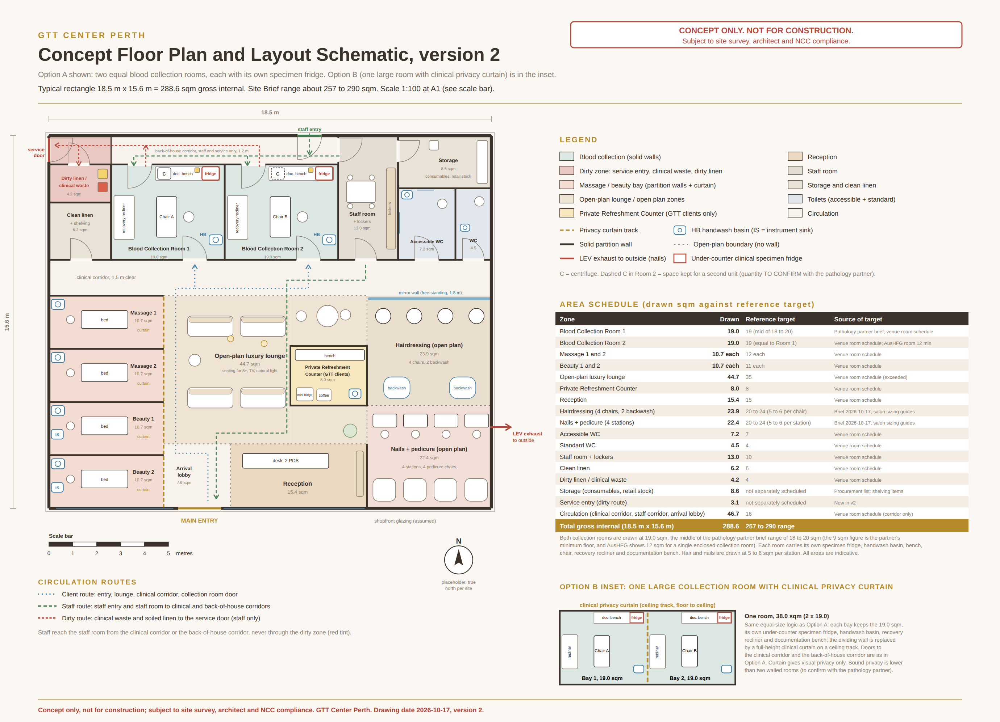

# GTT Center Perth

## Business Plan

**Western Australia's first premium waiting experience for expecting mothers having the Glucose Tolerance Test**

| | |
|---|---|
| **Prepared by** | Grace (Operations Manager) for Anthony Zed |
| **Date** | 2026-10-16 |
| **Status** | DRAFT for review. Not yet approved for release. |
| **Version** | v0.5 |
| **Business name** | GTT Center Perth (working name; the trading name is still to be confirmed, see Appendix C) |
| **Trading entity** | To be confirmed (the accountant and solicitor will advise; see Appendix D) |
| **Stage** | Pre-launch. No venue, no lease, no signed laboratory agreement, no trading data. |
| **Currency** | All figures in Australian dollars (A$) |

**Important notice.** Every financial figure in this plan is a planning estimate from a financial model. The business has not opened and has no trading history. Items marked "to be confirmed" are not yet settled and are listed with the reason in Section 10 and Appendix B. Nothing in this plan has been sent to a laboratory, landlord, lender or investor.

## 1. Executive Summary

**The business.** GTT Center Perth turns the 2 to 2.5 hour wait for the Glucose Tolerance Test (GTT) into a restorative visit. The GTT is a standard pregnancy screening test. The expecting mother fasts, then has blood drawn three times over two hours. Today the wait is spent in a pathology waiting room. At GTT Center Perth the expecting mother books and pays in advance, has her blood drawn on site in a private collection room by certified phlebotomists, and uses the time between draws for massage, nails, hair or beauty services in a calm lounge. In the afternoons the same premises sells wellness services and packages to expecting mothers who are not having the test.

**Why it should work.** The test is recommended for every pregnant woman and nearly every expecting mother is offered it. Greater Perth recorded 24,271 births in 2024, roughly 467 tests a week. Our research found no equivalent venue in Western Australia. This is our own finding, not an independent audit.

**The model.** Wellness staff are employed (casual or permanent). GTT takes up to 18 clients each morning, Monday to Saturday, with the first booking at 07:00 and pairs of clients starting every 25 minutes. Expecting mothers book 2 to 4 weeks ahead and a waitlist backfills cancellations. Staff are called in to match each morning's confirmed bookings, so idle staff are never rostered. GTT opens at full capacity: launch marketing and a pre-launch waitlist fill the diary before the first day, so the plan has no slow ramp-up period. Pathology testing and the courier are provided by the pathology partner, chosen from PathWest, Western Diagnostic Pathology (WDP) and Clinipath. GTT earns no pathology revenue.

### Key numbers card

| Measure | Base case (A$8,000 rent assumption) | At the A$10,500 gross rent ceiling |
|---|---|---|
| Morning capacity | 18 clients a day (9 pairs, 2 chairs, 25-minute cadence) | same |
| Steady-state operating profit, per month (from Month 1) | **+A$35,186.40** | **+A$33,936** |
| Conservative "GST-stress" case, per month | +A$23,443 | +A$22,306 |
| Break-even, morning clients a day | **8.266** (about 46% of capacity) | 8.455 |
| Year 1 net operating profit (12 full months) | **A$422,237** (GST-stress A$281,311) | GST-stress A$267,675 |
| Startup capital (base) | **A$336,198** | A$341,198 |
| Peak funding | **A$251,198** | A$256,198 |
| Lowest cash point | A$85,000 at opening | A$85,000 at opening |
| Payback | **Month 8** before GST timing, Month 11 after GST | not separately modelled |

**Conditions that travel with these numbers.**

1. **Rent.** The cost model uses A$8,000 a month. The approved rent budget is A$9,500 to A$10,500 a month. The right-hand column shows the A$10,500 gross ceiling (rent, outgoings and car bays all in).
2. **Fill rate is the central risk.** The model assumes every released morning place fills (100%) from the first day. Each 1% of fill at capacity is worth about A$1,185 a month. At 85% fill, profit is about +A$17.4k a month. At 70% fill GTT roughly breaks even. This is why the pre-launch waitlist and the 2 to 4 week booking window are core to the plan.
3. **Clinical staffing.** The plan keeps 2 phlebotomists on every testing morning, GTT's clinical standard, pending the pathology partner's answer on its collector requirements.

**Funding position.** The planning need is A$336,198 to A$361,198 (A$251,198 pre-opening capital plus A$85,000 to A$110,000 working capital). Funds on hand are about A$200,000 (founder savings, to be confirmed). The gap on the peak-funding basis is about A$51,198. The funding route is to be confirmed.

**Where we are.** No venue is secured. No laboratory agreement is signed. Both are launch gates (Section 11). Hiring and fit-out wait behind them.

## 2. Value Proposition

### 2.1 The problem

| Today | What expecting mothers get |
|---|---|
| Wait time | About 2 to 2.5 hours (some sources say up to 3) |
| Setting | A pathology waiting room, with draws at set times |
| Condition | Fasted, tired, unable to eat, unable to leave |
| Care during the wait | None |

The glucose tolerance test is optional: every expecting mother chooses whether to have it. It is recommended for all pregnant women, usually between 24 and 28 weeks, by the Australasian Diabetes in Pregnancy Society (2025 consensus recommendations), and it is routinely advised by doctors and midwives. The choice that remains is where to have it.

### 2.2 The solution

| Element | What GTT Center Perth provides |
|---|---|
| Blood collection | On site, in private collection rooms, by certified phlebotomists. Who employs the collection staff is subject to written confirmation from the pathology partner and Medicare (see Section 5.4). |
| The wait | Pregnancy massage, facials, nails, hair and brows between draws. Wellness services never interrupt a blood draw. |
| Lounge | Venue and lounge access (water and herbal tea) is free inside every package. In-lounge tablets are loaded with pregnancy guides and the intake forms. |
| Booking | Book and pay online in advance. Waitlist for popular mornings. |
| Results | The laboratory tests the samples and sends results to the expecting mother's doctor. GTT does not diagnose or interpret results. |

### 2.3 Honest view of the advantage

Demand is real and nearly universal, and we are first. The experience itself is not hard to copy. The lasting advantage has to be built from relationships with midwives and obstetricians, a compliant collection room and a trusted laboratory partner.

## 3. Perth Market Analysis

### 3.1 Market size

| Measure | 2023 | 2024 | Note |
|---|---|---|---|
| Registered births, Western Australia | 32,031 | 30,541 | Australian Bureau of Statistics |
| Registered births, Greater Perth | 25,436 | 24,271 | Australian Bureau of Statistics |
| Total fertility rate, Greater Perth | 1.58 | 1.47 | Births per woman |
| Perth births per week | 489 | 467 | 24,271 divided by 52 |
| Perth glucose tolerance tests per week (stand-in) | | about 467 | Births are used as a stand-in for tests. To be confirmed. |
| Women diagnosed with gestational diabetes | | about 18% nationally | Australian Institute of Health and Welfare, 2023-24 hospital data. National, not specific to Western Australia. |

*Source: Australian Bureau of Statistics, Births, Australia 2024 (released 15 October 2025) and Data by region.* **Update on release:** the Australian Bureau of Statistics publishes 2025 birth data on Friday 6 November 2026. GTT Center Perth will refresh this section the same day.

### 3.2 Our share of the market

Greater Perth recorded 24,271 births in 2024 (Australian Bureau of Statistics), about 467 a week. Gestational diabetes screening is offered to nearly every expecting mother, so we treat the weekly birth count as the weekly pool of glucose tolerance tests. At full capacity GTT Center Perth offers 108 morning testing places a week (18 a day over six days), about 23% of that pool. This is a ceiling on the places we can offer, not a forecast of bookings and not a claim of market control. Most expecting mothers will continue to be tested at their usual collection centre or hospital. GTT Center Perth is a premium, high-desire choice for the expecting mother who wants the wait to be comfortable and who books 2 to 4 weeks ahead. Our plan depends on filling our own places through referrals, the pre-launch waitlist and marketing, not on a large share of the market.

| Measure | Figure |
|---|---|
| Planning capacity | 108 morning places a week (18 a day, 6 days) |
| Capacity as share of Perth weekly tests | about 23% |
| Break-even volume as share of Perth weekly tests | about 10.8% (8.266 clients a day, about 50 a week, out of 467) |

The honest question is not whether the market is big. It is whether we can win roughly 1 in 9 Perth expecting mothers through referrals and keep every released morning full.

### 3.3 Referral window

A GTT is usually done at 24 to 28 weeks of pregnancy (earlier for women with risk factors). A valid pathology request form from a doctor, obstetrician or midwife is the standard requirement. Each expecting mother therefore has several mornings that suit her, which supports advance booking.

### 3.4 Competitors

| Competitor | What they offer | Position |
|---|---|---|
| Maternal and Infant Wellbeing Melbourne (MIWM) | GTT plus spa treatments, one client at a time. GP-led, clinical feel. Booked weeks ahead. | The only comparable business our research found in Australia. Victoria only. |
| Pathology collection rooms (PathWest, WDP, Clinipath and others) | The test only. Waiting room. | The current default. They are also potential partners. |
| Perth day spas | Discounted spa packages average about A$140. | Not GTT-linked. Price reference only. |
| Western Australian wellness-during-GTT venue | None found | Our research found no equivalent venue in Western Australia. |

**Benchmark: Maternal and Infant Wellbeing Melbourne (MIWM).** Parkville, Victoria, is a boutique GP-led women's health and baby clinic that sells a glucose tolerance test with spa treatments. Packages: A$50 standard, A$220 with one 60 minute treatment and a short GP consultation, and A$400 to A$435 with two 60 minute treatments. Clients are seen one at a time, are booked weeks ahead, book through the HealthEngine platform, and pay on the day. The clinic shows there is demand for a premium test day. GTT Center Perth differs in three ways: up to 18 expecting mothers each morning, full payment at booking, and a lounge built around the test rather than a clinic with a spa add-on.

| MIWM | GTT Center Perth |
|---|---|
| Single client at a time | Up to 9 pairs of clients a morning, staff rostered to bookings |
| Spa treatment fixed in the package | Expecting mother chooses her services |
| Pay on the day | Full payment at booking |
| No hairdressing | Full hairdressing menu |
| Victoria only | Western Australia |

*Sources are listed in Appendix A.*

## 4. Services and Pricing

### 4.1 Morning GTT packages

| Package | Price | What it includes |
|---|---|---|
| GTT Package 1 | **A$250** | Venue and lounge free, plus 2 x 30-minute services (fixed) |
| GTT Package 2 | **A$300** | Venue and lounge free, plus a choice of 2 x 45 minutes, 45 + 30 minutes, or 2 x 30 minutes |

- Every morning package includes any service on the menu that fits the 30 or 45 minute wellness window (see 4.3).
- No package is sold lounge-only. Prices are GST-inclusive.
- The financial baseline prices every morning client at A$250, a deliberately cautious assumption. Package 2 upgrades are upside, not counted.
- The pathology fee is billed separately by the laboratory. The estimated out-of-pocket cost is A$0 to A$80, pending partner confirmation.

### 4.2 Afternoon services

Afternoon services are stand-alone and pre-booked. They are not bound by the two-hour glucose test clock. Walk-ins are welcome when a therapist is free. The afternoon roster follows the pre-booked services.

| Offer | Price | What it is |
|---|---|---|
| PM Refresh | **A$185** | 75 minutes: massage plus mini facial (A$212 if bought separately) |
| PM Restore | **A$135** | 75 minutes: manicure plus blow-dry (A$150 if bought separately) |
| Individual services | See 4.3 | Available alongside the packages. Marketing leads with the packages. |

Afternoon capacity is 10 sessions a day in the financial model.

### 4.3 Full service menu

Afternoon services are standalone bookings. "Fits the morning window" means the service can be taken inside the 30 or 45 minute wellness window of a testing visit. Prices are our own and have not been tested with customers.

**Massage and beauty**

| Service | Duration | Price | Fits the morning window |
|---|---|---|---|
| Express pregnancy massage | 30 min | A$75 | Yes (30) |
| Standard pregnancy massage | 45 min | A$120 | Yes (45) |
| Full pregnancy massage | 60 min | A$145 | Afternoon only |
| Express glow facial | 30 min | A$95 | Yes (30) |
| Signature pregnancy facial | 45 min | A$130 | Yes (45) |
| Hydration facial | 60 min | A$145 | Afternoon only |
| Signature facial | 75 min | A$175 | Afternoon only |
| Brow thread and reshape | 15 min | A$38 | Yes (30 slot) |
| Brow wax and reshape | 20 min | A$45 | Yes (30 slot) |
| Brow wax and tint | 25 min | A$55 | Yes (30 slot) |
| Brow lamination | 45 min | A$75 | Yes (45) |
| Lash tint | 20 min | A$30 | Yes (30 slot) |
| Brow and lash tint combo | 35 min | A$80 | Yes (45 slot) |
| Lash lift and tint | 45 min | A$95 | Yes (45, tight) |

Facial add-ons (to a 45 minute facial or longer): LED light therapy +A$35 (15 min, second trimester onward); scalp massage +A$25; decolletage treatment +A$30; hand and arm massage +A$20; jade roller or gua sha +A$20; hydrating eye mask +A$15; lymphatic drainage facial massage +A$30; HA serum infusion +A$20; collagen sheet mask +A$25; aromatherapy +A$15; brow wax and tint during facial +A$45. Massage add-ons: scalp massage +A$25 and foot and lower leg massage +A$25 (15 min each).

**Nails**

| Service | Duration | Price | Fits the morning window |
|---|---|---|---|
| Classic manicure | 30 min | A$55 | Yes (30) |
| Gel manicure | 45 min | A$75 | Yes (45) |
| French gel manicure | 50 min | A$85 | Afternoon only |
| Express pedicure | 30 min | A$55 | Yes (30) |
| Spa pedicure | 45 min | A$65 | Yes (45) |
| Gel pedicure | 50 min | A$80 | Afternoon only |
| French gel pedicure | 55 min | A$90 | Afternoon only |
| Gel manicure and pedicure combo | 80 min | A$140 | Afternoon only |
| Acrylic full set | 75 to 90 min | A$90 to A$120 | Afternoon only |
| Acrylic infill | 45 to 60 min | A$60 to A$80 | 45 minute infills only |
| SNS or dip powder full set | 60 to 75 min | A$85 to A$110 | Afternoon only |

Nail add-ons: paraffin wax hands +A$30; paraffin wax feet +A$35; nail art +A$5 per nail; nail strengthening +A$15.

**Hair**

| Service | Duration | Price | Fits the morning window |
|---|---|---|---|
| Blow-dry, short to medium | 30 min | A$65 | Yes (30) |
| Blow-dry, long | 45 min | A$80 | Yes (45) |
| Haircut (no colour) | 30 to 45 min | A$60 to A$85 | Yes |
| Hair mask and blow-dry | 45 min | A$85 | Yes (45) |
| Braiding or hair up | 30 to 45 min | A$60 to A$75 | Yes |
| Cut and blow-dry | 60 min | A$95 | Afternoon only |
| Scalp treatment and blow-dry | 50 min | A$90 | Afternoon only |
| Toner or gloss | 30 min | A$65 | Afternoon only (no chemical treatments on test day) |
| Single process colour | 60 to 90 min | A$130 to A$200 | Afternoon only |
| Half foil highlights | 90 to 120 min | A$200 | Afternoon only |
| Full foil highlights | 2 to 3 hr | A$280 to A$350 | Afternoon only |
| Balayage, half head | 2 to 3 hr | A$270 | Afternoon only |
| Balayage, full head | 3 to 4 hr | A$360 to A$400 | Afternoon only |
| Colour and blow-dry (single process) | 2 to 3 hr | A$230 to A$280 | Afternoon only |

**Lashes**

| Service | Duration | Price |
|---|---|---|
| Classic full set | 90 min | A$140 |
| Hybrid full set | 2 to 2.5 hr | A$200 |
| Volume full set | 2 to 2.5 hr | A$280 |
| Classic infill | 50 min | A$99 |
| Hybrid or volume infill | 75 min | A$125 |

**Private Refreshment Counter** (for GTT clients only; pre-ordered or purchased; nothing is served during an active test): still water A$3, sparkling water A$4, herbal tea A$4, pregnancy-safe protein bar A$5 to A$7, fresh fruit cup A$5, coconut water or electrolyte drink A$5 to A$6, snack pack A$12. Retail: gestational diabetes snack pack A$20, low-GI recipe book A$30, pregnancy-safe nail polish A$18.

### 4.4 Revenue streams at steady state

| Stream | A$ per month | Share |
|---|---|---|
| Morning GTT packages (18 clients a day x A$250 x about 26.33 trading days) | 118,485.00 | about 83% |
| Afternoon services and packages (10 sessions a day) | 24,585.37 | about 17% |
| **Total revenue** | **143,070.37** | 100% |

Not counted in the baseline (upside only): refreshment counter and retail income, Package 2 upgrades, and staff downtime fill.

### 4.5 Revenue and profit strategy

Seven levers lift morning revenue and profit and seven reduce cost. Each shows the monthly effect worked from the plan's figures; estimates are marked. Baseline: revenue A$143,070 a month, costs A$107,884, net A$35,186 (A$422,237 a year), about 474 morning visits a month.

**Raise morning revenue and profit**

| # | Strategy | A$ effect per month | Basis |
|---|---|---|---|
| 1 | Show Package 2 (A$300, choice of 45 minute services) first at booking | Every 10% of morning clients choosing Package 2 adds 47 x A$50 = A$2,370 (A$28,440 a year). Staffing is already in place | Arithmetic; the 10% is a target |
| 2 | Add-ons sold at booking (facial add-ons A$15 to A$35, paraffin A$30 to A$35, scalp massage A$25, nail art A$5 a nail) | If 20% of visits take one add-on averaging A$25: about A$2,370 | Estimate |
| 3 | Pre-order refreshments with the booking (nothing is free) | If half of visits pre-order A$8 on average: about A$1,900 revenue, margin lower | Estimate |
| 4 | Counter retail: gestational diabetes snack pack A$20, recipe book A$30 | If 10% of visits buy one A$25 item: about A$1,185 | Estimate |
| 5 | Gift vouchers for families and baby showers | New customers rather than extra capacity | Not valued |
| 6 | Protect the 18 a day: full prepayment at booking, waitlist backfill, reminder messages | One recovered morning place a day = 22 x A$250 = A$5,500 a month | Arithmetic |
| 7 | Pre-launch waitlist so the venue opens at 18 a day | Opens at full capacity with no slow build-up | Built into the plan |

No price increase is planned in the first 12 months, so price is not a Year 1 lever.

**Reduce expenses**

| # | Strategy | A$ effect | Basis |
|---|---|---|---|
| 1 | Adaptive rostering: roster only the staff that confirmed bookings need | Largest lever: it lowers break-even by about 4.4 clients a day against a fixed full roster | Financial model |
| 2 | Rent in the lower half of A$9,500 to A$10,500 gross, and 3 to 6 months rent-free during fit-out | Each A$500 a month saved = A$6,000 a year. Three to six rent-free months at A$10,000 = A$30,000 to A$60,000, one-off | Arithmetic from the lease terms sought |
| 3 | Written wholesale per-test and collection fees from all three laboratories, then compare | Not valued until a fee is quoted | No fee quoted yet |
| 4 | Three insurance broker quotes | Not valued until quoted | Quotes pending |
| 5 | Stage marketing spend as channels prove themselves | Not valued | Marketing is held at A$1,500 a month in the model |
| 6 | Landlord fit-out contribution | Reduces startup capital | Not valued |
| 7 | One supplier for consumables, bundled with the fit-out sourcing packages | Not valued | Estimate once quotes exist |

### 4.6 Cross-selling testing clients into the afternoon

The afternoon runs 10 sessions a day (about 210 a month). The morning supplies about 474 testing clients a month, so it is the natural source. Because the model already counts afternoon capacity as full, cross-selling protects the A$24,585 afternoon revenue rather than adding to it, unless the 10-session limit is lifted.

1. At booking: show the afternoon menu and the PM Refresh (A$185) and PM Restore (A$135) packages beside the morning package.
2. At intake, with consent: record the due date and preferred treatments, and pregnancy-safe notes for the therapist.
3. During the visit: the therapist who gave the 30 or 45 minute treatment mentions the longer version (a 30 minute facial at A$95 against a 60 minute hydration facial at A$145).
4. At checkout: book a standalone afternoon treatment on the lounge tablet with the Test Day Thank You offer (Section 5.3), valid 14 days.
5. After the visit: a thank-you message (with consent) with the afternoon booking link; a second message at 34 to 36 weeks; a postnatal message after the due date.
6. Rebooking: every afternoon visitor is offered the next appointment at the desk, building a monthly treat rhythm until the due date.

If one in four testing clients books an afternoon treatment, that is about 118 sessions and A$13,800 a month of afternoon demand, more than half of what the afternoon needs. At one in ten it is 47 sessions and A$5,500.

## 5. Clinical Operations

### 5.1 Who does what

| Task | GTT Center Perth | Pathology partner |
|---|---|---|
| Venue, collection rooms, chairs | Provides | Inspects and approves |
| Collection staff (phlebotomists) | Proposed: GTT employs them, subject to written confirmation from the pathology partner and Medicare. The collector may need to be employed or engaged by the laboratory. | Must engage or credential them under its own quality system |
| Draws blood | The certified collection staff on site | Collection approval and oversight |
| Courier and laboratory testing | No | Yes (one courier pickup per day) |
| Medicare billing for the test | No. GTT earns nothing from pathology. | Yes |
| Results to the doctor | No | Yes |
| Diagnoses or interprets results | Never | Not applicable (the doctor does) |

Marketing must not say "we perform GTT testing". The phlebotomist's scope is pathology collection only.

### 5.2 Scheduling standard

| Item | Standard |
|---|---|
| First booking | 07:00. Expecting mothers arrive fasted, 10 minutes before their draw (06:50). |
| Chairs and phlebotomists | 2 chairs, 2 phlebotomists on every morning with any GTT booking |
| Cadence | One cadence only: the 25-minute pair cadence. Pairs start at 07:00, 07:25, 07:50 and so on. Nine pairs, up to **18 clients** a morning. Last first draw 10:20. |
| Last first-draw limit | No later than 10:30 (laboratory guidance) |
| Rostering | Staff are called in to match confirmed bookings, morning and afternoon. A morning with one booking runs 2 phlebotomists and 2 therapists. |
| Booking | 2 to 4 weeks ahead, prepaid, plus a waitlist |
| Trading days | Monday to Saturday |

### 5.3 One client, one visit

**Table 5.3: One client, one visit**

| Clock | Step |
|---|---|
| 06:50 | Arrives fasted, 10 minutes before the draw. Check-in, request form, Medicare card, two identity checks. |
| 07:00 (0 minutes) | Draw 1 (fasting, about 5 minutes), then the glucose drink |
| After Draw 1 | Wellness service 1 (30 or 45 minutes) |
| 60 minutes exactly | Draw 2. Wellness services never interrupt a draw. |
| After Draw 2 | Wellness service 2 (30 or 45 minutes) |
| 120 minutes exactly | Draw 3. The expecting mother may leave only after this. |
| After Draw 3 | Relax in the lounge, have something to eat or drink from the Private Refreshment Counter, or continue to pre-booked standalone services. |

The client stays on site and seated or escorted throughout. Services are low-activity only. Specimens are labelled at the chair, stored in a medical fridge at 2 to 8 degrees C, physically separate from the refreshment counter, and handed to the courier in one pickup per day.

**Refreshment counter.** There is no free meal. Expecting mothers pre-order food and drink when they book, or buy from the Private Refreshment Counter in the lounge. Nothing is served during an active test.

**Test Day Thank You.** Every expecting mother who books a standalone afternoon treatment within 14 days of her test receives an exclusive discount: advance booking only, one use per client, subject to availability. Proposed discount: 10% (to be set by Anthony; 15% and A$20 off are alternatives). The existing 10% online pre-booking discount applies when an afternoon treatment is booked with the test.

### 5.4 Pathology partner options

**Table 5.4: Pathology laboratory options**

| | Western Diagnostic Pathology (WDP) | PathWest | Clinipath |
|---|---|---|---|
| Role | Priority partner | Contingency | Contingency |
| Fee per test | No fee quoted yet | No fee quoted yet | No fee quoted yet |
| Collection or rental fee | No fee quoted yet | No fee quoted yet | No fee quoted yet |
| Courier | One pickup per day | Under assessment (grey top tubes may allow courier collection) | Not yet discussed |
| Turnaround | Not yet quoted | Not yet quoted | Not yet quoted |
| Contact status | In active discussion since July 2026; formal partnership steps requested | Replied in August 2026, progressing | Approached July 2026, awaiting reply |

No laboratory has yet quoted a fee. Written per-test and collection fees will be requested from all three before a partner is chosen.

**Pathology accreditation and approvals.** Pathology collection at GTT Center Perth operates under our pathology partner's accreditation and Medicare collection centre approval. The approval is held by the pathology company, not by GTT. The collection room is designed to the national standard for approved pathology collection centres and is a dedicated room (or a single large room with a clinical privacy curtain between two collection bays), with a hand wash basin in each bay. We have found no Western Australian state licence category for a private blood collection room, and will confirm this in writing with the Western Australian Department of Health. The pathology partner holds the Medicare collection centre approval and an occupation agreement for the collection room. Who employs the collectors is being confirmed with the partner so that the test remains bulk billed. If two collection rooms create an approval difficulty, the single large room with a curtain partition is the fallback design.

**Caveat that is not yet solved.** Only the pathology partner can hold the Commonwealth collection centre approval for a room, and two competing laboratories cannot both hold it for the same room. This, and the question of who must employ the collectors for Medicare billing, must be settled in writing with the chosen laboratory and an adviser before fit-out spending. Nothing is signed.

### 5.5 Compliance

**Table 5.5: Compliance**

| Area | Position | Status |
|---|---|---|
| Collection room standard | National Pathology Accreditation Advisory Council guidelines for Approved Pathology Collection Centres (third edition, 2013) | Design stage |
| Laboratory accreditation | Covered by the partner's accreditation. GTT needs none in its own name. | Under the partner |
| Phlebotomist qualification | Certificate III in Pathology Collection (code HLT37525). Phlebotomists are not registered with the Australian Health Practitioner Regulation Agency. | Hiring on hold |
| Beauty and nail services | Western Australian skin penetration regulations apply to these services only | To be met at fit-out |
| Privacy | Privacy Act 1988 (Cth). Health data is sensitive. GTT does not hold results. | Policy in draft |
| Consent form and privacy policy | Drafts. Solicitor review required before any client data is collected. | Open |
| Referral law | No payment, reward or perk to any doctor or midwife for referrals (Health Insurance Act 1973 (Cth) and advertising rules) | Policy set; wording review open |
| Insurance | Public liability, products liability, professional indemnity, workers compensation: no broker quote yet. Clinical and cyber cover to be settled. | Open |
| Western Australian licence for a blood collection room | No state licence category found | Confirm in writing with the Department of Health |
| Emergency procedures | Emergency plan drafted. Hypoglycaemia and needle-stick procedures still to be written. | Open |

General information only. Each item must be verified with the adviser or regulator before external reliance.

### 5.6 Healthcare referrals

GTT Center Perth does not pay, reward or offer perks to any doctor, midwife or other practitioner for referrals. Federal law prohibits benefits that induce pathology requests, and we keep clinical decisions independent. We provide neutral information to doctors and midwives so they can tell their patients that the service exists, and every expecting mother remains free to choose her own doctor and her own pathology collection site.

### 5.7 Risk protocol for pregnancy complications

Every client completes a pregnancy health declaration and consent form, and a request form check, before any service. Wellness services never interrupt a blood draw. Staff are first aid and CPR trained and are trained to recognise faintness and low blood sugar in fasting clients. Any collapse, fall, bleeding, pain, reduced baby movement or doubt stops all services immediately and triggers the emergency plan (000 where needed, and the pathology collector). Every event is recorded in an incident register, reported to our insurer within 24 hours, and reviewed monthly. Public and products liability, professional indemnity and workers compensation insurance cover the venue, and the clinical care of the test remains with the pathology partner.

## 6. Site and Premises

### 6.1 Requirements

| Item | Requirement |
|---|---|
| Floor area | **257 to 290 sqm** net usable. 257 sqm is the minimum. |
| Blood collection rooms | **2 dedicated rooms**, solid walls, one lockable door each, or one large room divided by a clinical privacy curtain between two bays. A hand wash basin in each bay. |
| Lounge | Open-plan luxury lounge with the **Private Refreshment Counter (exclusive to GTT clients)** |
| Rent budget | **A$9,500 to A$10,500 a month gross** (base rent plus estimated outgoings, excluding GST). A$10,500 is the hard all-in ceiling. |
| Level and access | Ground floor only, accessible path of travel, accessible toilet, doors at least 850 mm clear in clinical rooms |
| Parking | 8 to 10 or more client bays and 3 to 5 staff bays, well lit |
| Services | 3-phase power, plumbing for hands-free basins in each collection bay and at treatment bays, working ventilation and air conditioning, good internet |
| Hours | Monday to Saturday. Clients arrive from about 06:45. |
| Permitted use | Health, beauty and wellness services, including pathology specimen collection and a small refreshment counter |

### 6.2 Lease terms sought

| Term | Seeking |
|---|---|
| Initial term and option | 3 years plus a 3-year option |
| Rent review | Fixed percentage or CPI, no ratchet clause |
| Rent-free | 3 to 6 months during fit-out |
| Collection rooms | The lease must allow the pathology partner an occupation agreement for the collection room, and a change of partner later |
| Make-good | Negotiated. Avoid full reinstatement of blood room plumbing. |
| Personal guarantee | Cap at 6 months rent. Tenant entity to be confirmed. |
| Lease bond and legal | About A$19,600 to A$27,600 (modelled) |

No landlord contribution is counted in the financial model.

### 6.3 Target areas

**Table 6.3: Search corridors**

| Priority | Area | Why |
|---|---|---|
| 1 | Kwinana Freeway corridor: Murdoch, Myaree and the medical precincts around Fiona Stanley Hospital and St John of God Murdoch | Freeway access and the main health precinct south of the river |
| 2 | Cockburn and Jandakot | Southern corridor, freeway access, large catchment of young families |
| 3 | Cannington and East Cannington | Albany Highway and Roe Highway, near Bentley Health Campus |
| 4 | Osborne Park | Freeway access, strong parking stock |

The search corridor covers the Kwinana Freeway corridor, Cockburn, Jandakot, Cannington, Osborne Park, Murdoch and the medical precincts.

### 6.4 Property shortlist, redone October 2026

The property shortlist is being redone. The August list has been withdrawn after its leading site was leased on 24 August 2026. The October 2026 search is summarised below and will be updated weekly. Three listings are conditional matches on size and rent; none meets every criterion yet, and the search continues.

| Rank | Address | Size | Advertised rent | Position against criteria |
|---|---|---|---|---|
| 1 | [5 Fiona Wood Road, Murdoch](https://www.commercialrealestate.com.au/property/5-fiona-wood-road-murdoch-wa-6150-17678685) | 100 to 645 sqm ground floor, new development | Not published | Best location, details to confirm |
| 2 | [9/110-114 Bannister Road, Canning Vale](https://www.commercialrealestate.com.au/property/9-110-114-bannister-road-canning-vale-wa-6155-18063808) | 298 sqm | A$80,000 a year plus outgoings and GST (about A$8,900 to A$10,300 a month gross, indicative) | Fits size and rent, other criteria to confirm |
| 3 | [13/386 Scarborough Beach Road, Osborne Park](https://www.commercialrealestate.com.au/property/13-386-scarborough-beach-road-osborne-park-wa-6017-18315005) | 263 sqm | A$95,000 a year plus outgoings and GST (about A$9,900 to A$11,100 a month gross, indicative) | Rent at the ceiling |

The nearest medical building (25 Mills Street South, Cannington, 330 sqm) is advertised at A$15,000 a month before outgoings. No agent has been contacted.

**Status.** No venue, no lease, no heads of agreement. The collection room specification must be obtained in writing from the laboratories before any lease is signed. An architect will be engaged once a site is chosen. Fit-out has not been repriced for the larger footprint.

### 6.5 Concept floor plan

A concept floor plan and layout schematic is used to brief the architect, obtain fit-out quotes and source furniture and fixtures, including direct from China where compliant. It shows two dedicated blood collection rooms (with an inset for one large room divided by a clinical privacy curtain), an open-plan luxury lounge with the Private Refreshment Counter, massage and beauty bays with partition walls and privacy curtains, a handwash basin in every bay, and clinical waste and the specimen fridge kept physically separate from the refreshment counter. Concept layout of about 289 sqm, concept only, not for construction; subject to site survey, architect and building code compliance.

## 7. Marketing Strategy

### 7.1 Principle

The main customer channel for the morning GTT is the referring practice and the pre-launch waitlist, supported by paid and organic channels. Every expecting mother already needs a request form for the test. The task is to make the practice and the expecting mother aware that a better place to have it exists. The afternoon customer is more discretionary and finds us through Instagram, Google and word of mouth. Every ad, caption, card, voucher, email and web page is approved by Anthony before use.

### 7.2 Morning GTT: referral network

| Element | Plan |
|---|---|
| First-wave targets | 22 named practices already identified: 12 private midwifery practices and 10 obstetric and gynaecology clinics. None contacted yet. |
| Why these | Independent enough to recommend a collection venue. Hospital-based public clinics tend to have a default pathway, so the public-sector channel is lower priority. |
| Test batch | First 3 midwifery practices with a direct personal contact. Expand to the remaining 19 only after all 3 have a recorded outcome. |
| Approach | Personal visit or call first, then an information card, a one-page practice information sheet, and an invitation for the practice's staff to experience the service once open |
| Doctor channel | Target bulk-billing practices with high antenatal volume near the confirmed venue |
| Timing | Pre-launch activity that depends on a confirmed venue address |

Each visit must end in one recorded outcome: the practice displays cards, accepts a complimentary visit, or declines. Tracking uses the "How did you hear about us?" field in the booking system; it is a named Venue Manager responsibility from week 1 of opening. **Referral law.** No doctor or midwife receives a payment, gift or other benefit for referring a client (Section 5.6).

### 7.3 Online booking and waitlist

| Element | Plan |
|---|---|
| Website | Waitlist form (name, email, mobile, suburb, due date, services of interest, how they heard of us), how-it-works page, service menu with prices, embedded online booking, FAQ |
| Booking | Online, prepaid, 2 to 4 weeks ahead. Roster published 1 to 2 weeks ahead from confirmed bookings. |
| Waitlist role | Fills the diary before opening so GTT opens at 18 bookings a morning, then backfills cancellations |
| Waitlist targets | 100 sign-ups by week 13 and 300 or more by week 18 (planning target, to be tested against the 18 a day capacity) |
| Waitlist launch | 48-hour priority booking window for waitlist members before public launch |

### 7.4 Marketing channels

| Channel | What we do | Measure |
|---|---|---|
| Meta Ads (Facebook and Instagram) | Two campaigns: waitlist sign-up from the pre-launch stage (expecting mothers 18 to 28 weeks, Perth metro, 25 to 40), then a booking campaign once open. "Your glucose tolerance test, without the waiting room. Book 2 to 4 weeks ahead." Image of the lounge, not blood. No health outcome claims. | Cost per waitlist sign-up; cost per booking |
| Instagram Reels | Three series, three posts a week: "Test day at GTT Center Perth", "What to pack for your glucose test", "Behind the lounge". Captions say booking is by appointment, 2 to 4 weeks ahead. | Reach, saves, waitlist link clicks |
| Google Search | Search ads and a landing page for "glucose tolerance test Perth", "GTT Perth", "gestational diabetes test Perth", and for the afternoon "pregnancy massage Perth". No claims about the pathology result. | Click to booking rate |
| Google Maps (Business Profile) | Claim and complete the profile at opening: category, hours (Monday to Saturday), photos, services, booking link. Ask every client for a review with no reward. Reply to every review without discussing any client's health in public. | Profile views, direction requests, review count and score |
| Word of mouth | A friend card in every takeaway bag; a gift voucher for baby showers; a "bring a friend" afternoon booking. Any discount is a published offer open to everyone, never tied to a doctor or midwife. | Share of bookings that name a friend |

Advertising rules: no testimonials about clinical care, and no claim that we improve a test result or any health outcome.

### 7.5 Events across Perth

| Date | Event | Audience | Action |
|---|---|---|---|
| Sunday 18 October 2026 | Perth Pregnancy, Birth and Postpartum Expo, Scarborough (free) | Expecting mothers, doulas, midwives | Attend as a visitor. Confirm the date with the organiser first. |
| Friday 6 November 2026 | Australian College of Midwives Western Australia State Conference | Midwives | Ask about delegate or sponsor options |
| 10 and 11 April 2027 | Pregnancy, Babies and Children's Expo, Perth Convention and Exhibition Centre | Largest early-parenting audience in Western Australia | Decide whether to exhibit |
| About June 2027 | GP seminar on women's and children's health (Healthed) | Doctors | Watch for the 2027 date |
| About September 2027 | St John of God Women's Health Masterclass | Doctors, women's health clinicians | Watch for the 2027 date |
| About June 2027 | RACGP Western Australia faculty education day | Doctors | Watch for the 2027 date |

No public series of dated Perth GP and midwife breakfast events was found. Plan: host our own GP and midwife morning tea at the venue once it is fitted (three sessions in the first quarter, light breakfast, a short walk-through of the testing day, no payment or gift to any attendee). Dates are to be confirmed after a venue exists. Dates marked "about" follow the pattern of the 2026 events and are not announcements.

### 7.6 Notifying Perth doctors and private obstetricians

We will notify Perth GPs and private obstetricians through WA Primary Health Alliance and HealthPathways WA, practice visits with an information sheet and booking cards, and a quarterly email to practice managers. No doctor or midwife receives a payment, gift or other benefit for referring a client. The information sheet says what the service is, hours, how to book, that the test follows the laboratory partner's process, and that GTT Center Perth does not diagnose or interpret results.

**Expecting mothers without a request form.** Expecting mothers need a request form for the test. Those without one are pointed to their doctor, midwife or obstetrician, and told that some online telehealth doctors can issue a pathology request when clinically appropriate. Expecting mothers who do not yet have a referral can see their own doctor, midwife or an independent telehealth doctor of their choice. GTT has no commercial relationship with, and receives or pays no money to, any doctor or telehealth service.

**Public hospital patients.** For expecting mothers who prefer a calm, private setting, GTT Center Perth offers an appointment-based alternative to a busy collection centre, including for patients of King Edward Memorial Hospital and Fiona Stanley Hospital who want comfort over a crowded waiting room. Public hospital collection remains an excellent option. We make no claim of shorter waits or better clinical care.

### 7.7 Afternoon demand

| Element | Plan |
|---|---|
| Offer | Lead with PM Refresh and PM Restore. Individual services stay visible as a secondary option. |
| Cross-selling | Testing clients are offered afternoon treatments (Section 4.6) with the Test Day Thank You discount. |
| Partners | Prenatal yoga studios, women's health physiotherapists, antenatal class providers, doulas, maternity retailers and pregnancy photographers |
| Group bookings | Antenatal cohorts, baby-shower groups, mother and daughter visits |
| Paid search | Separate afternoon campaign for pregnancy wellness terms |
| Retention | Post-visit review request and a re-booking nudge |

Afternoon volume is a modelled assumption of 10 sessions a day. It has no booking data behind it yet.

### 7.8 After-hours workshops

Evenings and Saturday afternoons, when the lounge is otherwise closed, host antenatal and birth education run by qualified midwives, physiotherapists and lactation consultants. Prices are proposals in line with Perth classes (a comparable Perth two-evening course is A$150 a couple).

| Workshop | Format | Who runs it | Capacity | Proposed price (for Anthony to set) |
|---|---|---|---|---|
| Birth Basics | Two weekday evenings, 6.30 to 8.30 pm | Registered midwife or childbirth educator, engaged as a contractor | 12 couples | A$150 to A$180 per couple |
| Birth Preparation Saturday | One Saturday afternoon, 1.30 to 5.30 pm, with afternoon tea from the refreshment counter | Midwife plus physiotherapist | 12 couples | A$190 to A$240 per couple |
| Hypnobirthing | Three weekend sessions | Accredited hypnobirthing practitioner | 8 couples | A$285 to A$300 per couple |
| Feeding and Settling Night | One evening, 2 hours | Lactation consultant | 15 parents | A$45 to A$60 per person |
| Prenatal Yoga | Weekly evening, 60 minutes | Qualified prenatal yoga teacher | 10 | A$25 to A$35 per person |

Instructors are independent, insured and qualified. The venue provides the room, bookings, refreshments and marketing, and shares revenue (suggested split 60% instructor, 40% venue, an estimate to test with the first instructor). Four Birth Basics courses a year would add about A$3,000. Workshops serve clients and feed the afternoon menu; they are not a main profit line. Classes are education, not medical advice.

### 7.9 Postnatal strategy

With her consent, each expecting mother's due date is recorded at booking so we can send timed, optional offers: a pregnancy massage reminder at 34 to 36 weeks and a postnatal treatment about two weeks after her due date. Messages stop on request. A due date is health information, so consent is explicit, optional and withdrawable under the Privacy Act. The privacy policy and consent form go to a solicitor before use.

## 8. Team and Staffing

### 8.1 Principle: adaptive rostering

Staff are called in to match the confirmed bookings, morning and afternoon. GTT never rosters idle staff. A morning with one booking runs two phlebotomists and two therapists, not a full team. Staffing follows overlap, not headcount: each client has two services and pairs start 25 minutes apart. One client needs 2 phlebotomists and 2 therapists. Two to nine clients, one per slot, need 2 phlebotomists and 4 therapists. Ten clients need 6 therapists. Eleven to eighteen clients need the full 8 therapists (4 massage and beauty, 2 nails, 2 hair). At about 12.6 booked clients the roster is 8 therapists because neighbouring double-booked slots put four first services in the room at once; if second-chair bookings fall in alternate slots, 6 are enough. The roster is published one to two weeks ahead from the confirmed bookings. Afternoon sessions are fully adaptive and follow the pre-booked standalone services; walk-ins are accepted only when staff are free.

### 8.2 People on the books

GTT keeps 21 people on the books: 1 Venue Manager; 4 phlebotomists; 12 morning therapists (6 massage and beauty, 3 nail technicians, 3 hairdressers); and 4 afternoon therapists (massage, beauty, nails, hair). Only 2 phlebotomists and up to 8 therapists work any one morning. The extra people cover leave, illness and Saturdays, sized so that at least 95% of days are fully staffed (phlebotomists 99.8%). All are casual initially, reviewed for part-time after 3 to 6 months. Employment type for the Venue Manager and phlebotomists is to be confirmed.

| Role | Number | Basis | Notes |
|---|---|---|---|
| Venue Manager | 1 | Monday to Friday, 07:00 to 15:00 | Not yet hired. Covers reception from 07:00 and is the first responder, first aider, EpiPen holder and fire warden. An experienced rostered staff member covers reception on Saturday. Hire is gated behind the laboratory agreement and the venue. |
| Phlebotomists (certified) | 2 on shift, 4 on the books | Casual, review at 3 to 6 months | Collection Room 1 and Collection Room 2, 07:00 to 13:00. Relief pool because nobody else can cover phlebotomy. Employer subject to written confirmation from the pathology partner and Medicare. |
| Morning therapists | up to 8 on a full morning | Casual, dual-qualified where possible | 4 massage and beauty, 2 nails, 2 hair |
| Afternoon therapists | 4 | Casual, paid for hours worked | Massage, beauty, nails, hair, cross-qualified with the morning pool |
| Reception | No separate role | Venue Manager covers the morning shift. Rostered afternoon staff cover check-in. | |

**Hiring priority.** Therapists qualified in massage and in beauty or nails. One person can deliver either service in the same 30 or 45 minute slot and follow a testing client into an afternoon treatment, which keeps rostering adaptive and idle time low.

Awards: Hair and Beauty Industry Award (MA000005) and Health Professionals and Support Services Award (MA000027). Pay-rate clauses are to be confirmed with Fair Work. Superannuation is costed at 12% and workers compensation at 1.7%.

### 8.3 Morning roster by booked volume

**Table 8.3: Roster by booked volume (25-minute cadence)**

| Booked | Phlebotomists | Therapists (massage and beauty / nails / hair) | Last first draw | Labour per morning | Revenue per morning | Contribution per morning |
|---|---|---|---|---|---|---|
| 1 | 2 | 2 (1/1/0) | 07:00 | A$975.96 | A$250 | -A$725.96 |
| 2 | 2 | 4 (2/2/0) | 07:25 | A$1,482.90 | A$500 | -A$982.90 |
| 3 | 2 | 4 (2/2/0) | 07:50 | A$1,482.90 | A$750 | -A$732.90 |
| 4 | 2 | 4 (2/2/0) | 08:15 | A$1,482.90 | A$1,000 | -A$482.90 |
| 5 | 2 | 4 (2/2/0) | 08:40 | A$1,482.90 | A$1,250 | -A$232.90 |
| 6 | 2 | 4 (2/2/0) | 09:05 | A$1,482.90 | A$1,500 | A$17.10 |
| 7 | 2 | 4 (2/2/0) | 09:30 | A$1,482.90 | A$1,750 | A$267.10 |
| 8 | 2 | 4 (2/2/0) | 09:55 | A$1,482.90 | A$2,000 | A$517.10 |
| 9 | 2 | 4 (2/2/0) | 10:20 | A$1,482.90 | A$2,250 | A$767.10 |
| 10 | 2 | 6 (3/2/1) | 10:20 | A$1,989.84 | A$2,500 | A$510.16 |
| 11 | 2 | 8 (4/2/2) | 10:20 | A$2,496.78 | A$2,750 | A$253.22 |
| 12 | 2 | 8 (4/2/2) | 10:20 | A$2,496.78 | A$3,000 | A$503.22 |
| 13 | 2 | 8 (4/2/2) | 10:20 | A$2,496.78 | A$3,250 | A$753.22 |
| 14 | 2 | 8 (4/2/2) | 10:20 | A$2,496.78 | A$3,500 | A$1,003.22 |
| 15 | 2 | 8 (4/2/2) | 10:20 | A$2,496.78 | A$3,750 | A$1,253.22 |
| 16 | 2 | 8 (4/2/2) | 10:20 | A$2,496.78 | A$4,000 | A$1,503.22 |
| 17 | 2 | 8 (4/2/2) | 10:20 | A$2,496.78 | A$4,250 | A$1,753.22 |
| 18 | 2 | 8 (4/2/2) | 10:20 | A$2,496.78 | A$4,500 | A$2,003.22 |

Weekday labour with superannuation and workers compensation; bookings assumed to fill from 07:00, one per slot first. Saturday labour is 1.5 times. The Venue Manager is a fixed cost and is not in these figures. The minimum of 2 phlebotomists on every testing morning is GTT's clinical standard, pending the pathology partner's answer.

### 8.4 Hiring sequence

Recruitment documents are prepared. Hiring starts only after the laboratory agreement and venue are secured, then the Venue Manager first, then phlebotomists and treatment staff, then training and test runs. This compresses the hiring window once the gates clear (see Section 10).

### 8.5 Position register

Every position reports to the Venue Manager except GTT-01, who reports to the Founder (Anthony Zed). The employing entity is to be confirmed.

| Position number | Title | Employment type | Task and job description |
|---|---|---|---|
| GTT-01 | Venue Manager (to be hired) | Full-time, Monday to Friday, 07:00 to 15:00 (salaried or casual to be confirmed) | Runs daily operations; rosters staff and checks Fair Work compliance; covers reception from 07:00 (an experienced rostered staff member covers Saturday); first aider, fire warden, EpiPen holder, escalation contact; liaises with the pathology partner; weekly profit and loss review |
| GTT-02 | Phlebotomist, Collection Room 1 | Casual (part-time to be confirmed) | Three timed blood draws per client (0, 60, 120 minutes); glucose drink; specimen labelling and dispatch logs; vasovagal response; credentialed under the pathology partner |
| GTT-03 | Phlebotomist, Collection Room 2 | Casual | As GTT-02; second on-site collector for difficult draws |
| GTT-04, GTT-05 | Phlebotomist, relief | Casual, on call | As GTT-02; cover leave and absences |
| GTT-06 to GTT-09 | Massage and Beauty Therapist (morning) | Casual | Pregnancy massage and pregnancy-safe facials in the 30 or 45 minute wellness window; Certificate IV; booking system check-in |
| GTT-10, GTT-11 | Massage and Beauty Therapist, relief (morning) | Casual, on call | As GTT-06 |
| GTT-12, GTT-13 | Nail Technician (morning) | Casual | Manicure, pedicure and add-ons in the wellness window |
| GTT-14 | Nail Technician, relief (morning) | Casual, on call | As GTT-12 |
| GTT-15, GTT-16 | Hairdresser (morning) | Casual | Blow-dry, styling, hair up in the wellness window |
| GTT-17 | Hairdresser, relief (morning) | Casual, on call | As GTT-15 |
| GTT-18 | Massage Therapist (afternoon) | Casual | Stand-alone pre-booked massage and Refresh package; covers check-in and payment in booking gaps |
| GTT-19 | Beauty Therapist (afternoon) | Casual | Stand-alone facials and Refresh package; as GTT-18 |
| GTT-20 | Nail Technician (afternoon) | Casual | Stand-alone nails and Restore package (nails half); as GTT-18 |
| GTT-21 | Hairdresser (afternoon) | Casual | Stand-alone hair and Restore package (hair half); as GTT-18 |

### 8.6 Saturday profitability

Saturday mornings earn their keep. At 18 clients: revenue 18 x A$250 = A$4,500. Staff at Saturday rates (1.5 times): 4 massage and beauty therapists A$1,350.00, 2 nail technicians A$662.58, 2 hairdressers A$662.58, 2 phlebotomists A$618.75 = A$3,293.91; plus 12% superannuation A$395.27 and 1.7% workers compensation A$56.00 = A$3,745.18. Contribution **+A$754.82 per Saturday** (about A$3,268 a month). The Venue Manager does not work Saturdays and rent is fixed, so this is extra profit. A Saturday covers its own staff from 9 clients with the 4-therapist roster (+A$25.65) and from 15 clients with the full roster (+A$4.82).

## 9. Financial Summary

Full statements are in the companion documents:

| Document | Contents |
|---|---|
| [Projected Profit and Loss (PDF)](https://dash.anthonyzed.work/gtt-docs/profit-and-loss.pdf) | Monthly and annual profit and loss |
| [Cashflow Forecast (PDF)](https://dash.anthonyzed.work/gtt-docs/cashflow-forecast.pdf) | Monthly cash, funding and GST timing |
| [This business plan (PDF)](https://dash.anthonyzed.work/gtt-docs/business-plan.pdf) | The complete plan |

### 9.1 Steady state (from Month 1, 18 clients a day, A$8,000 rent assumption)

| Line | A$ per month | A$ per year |
|---|---|---|
| Revenue | 143,070.37 | 1,716,844.44 |
| Payroll (including superannuation and workers compensation) | 93,595.63 | |
| Other costs (direct costs, rent budget A$8,000, insurance, administration) | 14,288.34 | |
| **Total costs** | **107,883.97** | 1,294,607.64 |
| **Operating profit** | **+35,186.40** | **+422,236.80** |
| Profit margin | about 24.6% | |

**Margin commentary.** A 24.6% net operating margin (A$35,186 on A$143,070 of monthly revenue) is exceptional for a health-adjacent service business, and it holds with a break-even at under half of capacity.

### 9.2 Profit under different rent and tax cases

| Case | Net per month | GST-stress net per month | Break-even (clients a day) | Peak funding | GST-stress Year 1 |
|---|---|---|---|---|---|
| Base, A$8,000 rent | +A$35,186 | +A$23,443 | 8.266 | A$251,198 | A$281,311 |
| A$10,500 gross ceiling, all-in | +A$33,936 | +A$22,306 | 8.455 | A$256,198 | A$267,675 |
| A$10,500 plus separate utilities and cleaning (prudent) | +A$32,686 | +A$21,170 | 8.645 | A$256,198 | A$254,038 |

**What is GST-stress?** GST-stress is our safety test. It assumes the Australian Taxation Office treats the whole package as taxable, so one eleventh of every sale is paid away as GST. Even then, GTT still earns A$23,443 a month (A$281,311 over a first year at full capacity), against A$35,186 a month before the test. GST-stress first-year net is A$254,038 to A$281,311 across the rent range of A$10,500 to A$8,000 a month. Whether part of the package is GST-free is a question for our accountant. GST-stress is the prudent planning case.

### 9.3 Year 1 at full capacity

**Table 9.3: Year 1 net operating profit (no ramp-up)**

| A$ | Per month | Year 1 (12 months) |
|---|---|---|
| Revenue | 143,070.37 | 1,716,844.44 |
| Total costs | 107,883.97 | 1,294,607.64 |
| **Net operating profit** | **35,186.40** | **422,236.80** |
| GST-stress net | 23,442.58 | 281,310.96 |

Every month is a full-capacity month: 18 expecting mothers each morning, from Month 1. Earlier drafts showed a Year 1 profit of A$322,015 (A$196,609 under GST-stress). Those figures assumed four months of gradual build-up to full capacity. With a pre-launch waitlist filling the diary from the first day, there is no build-up, so Year 1 is simply twelve months at the steady-state profit and the earlier figures are replaced.

**What is the A$422k a year steady state?** At full capacity, 18 expecting mothers every morning, GTT earns A$35,186 a month in net operating profit. Twelve months of that is A$422,237 a year. Net margin is 24.6%.

**The risk.** This depends on the waitlist delivering a full morning on opening day: at 85% of capacity profit is about A$17,400 a month; at 70% GTT roughly breaks even.

### 9.4 Startup capital and funding

| Item | A$ |
|---|---|
| Pre-opening capital | 251,198 |
| Opening working capital reserve | 85,000 (up to 110,000) |
| **Startup capital, base** | **336,198** |
| Startup capital at the A$10,500 rent cases | 341,198 |
| Peak funding actually drawn | 251,198 |
| Lowest cash point | 85,000 at opening (the reserve is never drawn) |
| Funds on hand (founder savings, to be confirmed) | about 200,000 |
| Gap on the peak-funding basis | about 51,198 |
| Gap on the combined planning case (336,198 to 361,198) | about 136,198 to 161,198 |

Of the pre-opening capital, fit-out and construction is the largest group (A$139,678 in the base case). Month 1 already makes a profit, so the A$85,000 reserve is available for the larger floor area fit-out, cafe equipment and rent during fit-out, none of which is in the base. A quantity surveyor and builder quotes will confirm the startup budget. The accountant will advise on the funding route.

### 9.5 Sensitivities

| Scenario | Net per month |
|---|---|
| Base (100% fill) | +A$35,186 |
| 85% fill | about +A$17.4k (payback Month 16 before GST timing) |
| 70% fill | roughly break-even (-A$359) |
| Volume down 20% | +A$19,573 |
| Morning price down 10% (A$225) | +A$20,879 |
| Each A$10 per client of laboratory fee | about A$4,739 less at capacity |

### 9.6 Tax, GST and structure

**GST.** The glucose tolerance test and its specimen collection are provided and billed by our pathology partner as a GST-free medical service. GTT Center Perth's own supplies, the Wellness Lounge, treatments and Private Refreshment Counter, are taxable and priced GST-inclusive. Package invoices are itemised so each supply is shown separately. We register for GST and claim back the GST on our fit-out, equipment and supplies. The base case profit figures carry no GST deduction and are subject to an Australian Taxation Office private ruling. Our financial plan already assumes the entire package is taxable (the GST-stress case, our prudent planning case), so any GST-free element confirmed by the Australian Taxation Office would be additional profit, not a plan requirement. Each percentage point of the A$250 package that is confirmed GST-free would be worth about A$108 a month at 18 clients a morning. No split is used to reduce GST: the Australian Taxation Office treats contrived splits as avoidance.

**GST ruling.** Before the first taxable sale, our accountant will apply to the Australian Taxation Office for a private ruling confirming the GST treatment of our packages and any collection-related services. The Australian Taxation Office aims to finalise most private rulings within 28 days of receiving all information. Until a ruling is received, we price and plan on the fully taxable basis.

**Pathology fees.** The glucose tolerance test is billed by the pathology partner to Medicare, and bulk billed for Medicare card holders, so GTT Center Perth carries no pathology cost or revenue on that test. We will obtain written fee schedules from PathWest, Western Diagnostic Pathology and Clinipath for private (non-Medicare) clients, consumables, courier and collection room terms, and negotiate wholesale per-test pricing on the basis of expected volume. No laboratory fee is included in the plan until confirmed in writing.

**Proposed minimum tax.** A proposed 30% minimum tax on discretionary trusts from 1 July 2028 is an exposure draft, not law. Accountant review is needed.

**Trading entity.** To be confirmed (Appendix D).

## 10. Risks and Mitigations

| # | Risk | Level | Mitigation |
|---|---|---|---|
| 1 | No venue secured. Blocks hiring, fit-out and everything after. | Critical | Three conditional matches. Enquire with agents (with approval), inspect, search weekly. |
| 2 | No signed laboratory agreement. No fees quoted. Who employs the collectors for Medicare billing is unresolved. | High | Written fee schedules from all three. Written answer from the partner and Medicare before fit-out spending. |
| 3 | Funding gap. Planning need A$336k to A$361k against about A$200k on hand. Peak funding A$251,198. | High | Founder funding decision. Accountant. Staged fit-out. |
| 4 | Fill rate. Full capacity is assumed from day one. 85% fill gives about +A$17.4k a month and 70% roughly breaks even. | High | Pre-launch waitlist and marketing. Book 2 to 4 weeks ahead. Track fill weekly against an 85% warning line. |
| 5 | Cost model uses A$8,000 rent but budget is A$9,500 to A$10,500. | Medium | Net at the new rent is about +A$32,686 to +A$33,936 a month, shown beside the headline. |
| 6 | Courier arrangement unconfirmed. | Medium-High | Confirm one pickup a day in writing with the chosen laboratory. |
| 7 | Collection room approval and cost. Architect not engaged. | Medium | Brief an architect after the site is picked. Confirm requirements with the partner and the Department of Health. |
| 8 | Insurance not yet quoted, including the clinical line. | Medium-High | Obtain broker quotes before any commitment. Insurance is a launch gate. |
| 9 | Safety cover depends on one not-yet-hired Venue Manager. | Medium-High | Cross-train a backup responder. The venue does not open without this cover. |
| 10 | Referral law and the draft consent and privacy documents. | Medium | Solicitor review before any client or waitlist data is collected. No benefit to any referrer. |
| 11 | GST treatment is unsettled. | Medium | Accountant and private ruling. GST-stress is +A$23,443 a month. |
| 12 | Pregnancy complications on site (liability). | Medium | Risk protocol (Section 5.7), incident register, insurance. |
| 13 | Proposed 2028 minimum tax on discretionary trusts. | Low-Medium | Annual accountant review of the entity structure. |
| 14 | Hiring window compresses once the gates clear. | Medium | Job documents are pre-built so recruitment starts the day the gates clear. |
| 15 | Copycat entering Western Australia. | Low-Medium | First-mover position, referral relationships, brand, and a compliant collection room. |

Risks 1 to 3 are one single point of failure: no site and no laboratory partner means no revenue. The order of fixing matters more than anything else in this table.

## 11. Growth Roadmap and Launch Gates

No calendar dates are set. The venture holds launch undated until the gates clear.

### 11.1 Stages

| Stage | What happens | Gate | Status |
|---|---|---|---|
| 0 | Venue search. Laboratory talks. Waitlist can start early. | none | In progress |
| Gate A | Laboratory agreement in place, with written terms and the collection approval and collector arrangement | Written terms | Open |
| Gate B | Venue confirmed, lease reviewed by a solicitor | Site and lease terms | Open |
| 1 | Venue Manager hire. Lease or heads of agreement. Architect and fit-out quotes. | A and B | Not started |
| 2 | Phlebotomist and treatment staff recruitment and contracts | Venue Manager in place | Not started |
| 3 | Partner site inspection, training, test runs, soft open for the waitlist, public launch | Fit-out done, staff hired | Not started |
| Go-live | First confirmed customer booking. The venture moves from standby to active. | | Not started |

### 11.2 Launch gate checklist

| Gate | Condition | Status |
|---|---|---|
| G1 | Signed laboratory agreement: fees, courier, term, collection approval, collector arrangement | Open |
| G2 | Venue secured (257 to 290 sqm, 2 collection rooms or one large room with curtain, rent within A$9,500 to A$10,500) and lease reviewed | Open |
| G3 | The laboratory signs off the room and credentials the collection staff | Not started |
| G4 | Insurance bound, including the clinical line | Open |
| G5 | Venue Manager hired (first aid, EpiPen, fire warden) | On hold |
| G6 | Phlebotomists, relief pool and casual treatment pool hired | On hold |
| G7 | Consent, privacy and referral-law advice cleared | Open |
| G8 | First confirmed booking activates the venture | Not started |
| G9 | Booking and waitlist system live: prepaid booking 2 to 4 weeks ahead, waitlist, roster published 1 to 2 weeks ahead | Not started |
| G10 | Weekly fill-rate tracking against the 85% warning line | Not started |

### 11.3 Decisions needed

| # | Decision | Owner |
|---|---|---|
| 1 | Request written wholesale per-test and collection fees from all three laboratories, and ask who must employ the collectors | Anthony, Reed |
| 2 | Approve agent enquiries for the shortlisted sites | Anthony |
| 3 | Decide how to cover the funding gap and brief the accountant on entity structure | Anthony |
| 4 | Appoint an architect once a site is chosen, using the concept floor plan | Anthony |
| 5 | Accountant: apply for the GST private ruling and confirm the invoice structure | Anthony |
| 6 | Set the Test Day Thank You discount and confirm the phlebotomist minimum | Anthony |
| 7 | Build the booking and waitlist system and weekly fill tracking | Ivy |

### 11.4 Growth options (not in the baseline)

| Option | Status |
|---|---|
| Fill rate above plan, Package 2 upgrades, downtime fill | Upside, unproven |
| Postnatal offers in the afternoon (Section 7.9) | Idea only |
| After-hours workshops (Section 7.8) | Proposal |
| Third collection chair or room | Undecided |

## 12. Appendix

### Appendix A. Sources

Figures and facts in this plan come from the following, in plain terms.

- **GTT Center Perth financial model, version 0.5 (October 2026):** all financial figures, the profit and loss, the cashflow forecast and the roster costs.
- **GTT Center Perth operating documents:** clinical operations plan, commercial site brief, launch readiness tracker, staff profiles, service pricing and afternoon packages, marketing and referral plans.
- **Australian Bureau of Statistics,** Births, Australia 2024 and Data by region: [abs.gov.au](https://www.abs.gov.au/statistics/people/population/births-australia/latest-release). The 2025 release is due on 6 November 2026.
- **Australian Institute of Health and Welfare,** gestational diabetes (2023-24), national hospital data.
- **Australasian Diabetes in Pregnancy Society,** consensus recommendations (2025) on gestational diabetes screening.
- **National Pathology Accreditation Advisory Council,** Guidelines for Approved Pathology Collection Centres (third edition, 2013).
- **Australian Taxation Office,** GST and health guidance and private rulings: [ato.gov.au](https://www.ato.gov.au/businesses-and-organisations/gst-excise-and-indirect-taxes/gst/in-detail/your-industry/gst-and-health).
- **Maternal and Infant Wellbeing Melbourne,** public website and directory listing: [miwm.com.au](https://www.miwm.com.au).
- **Commercial property listings** viewed on 16 October 2026 at commercialrealestate.com.au (linked in Section 6.4).
- **Event organisers and professional bodies** named in Section 7.5.

External regulatory points in this plan are general information and must be verified with the relevant adviser or regulator (Western Australian Department of Health, the Australian Health Practitioner Regulation Agency where applicable, Fair Work, the Australian Taxation Office) before external reliance.

### Appendix B. Items to Confirm

The authoritative index of open items. Status: BLOCKING (the venture cannot move past it), OPEN, IN PROGRESS, WAITING (on a third party), DATED (fixed date), NOT STARTED.

**Blocking and dated items**

| Item | Owner | Blocking | Status |
|---|---|---|---|
| Venue location | Anthony | Lease, fit-out, hiring | Blocking |
| Rent: gross A$9,500 to A$10,500 a month confirmed | Anthony, agent | Lease | Open |
| Pathology partner fee and agreement | Anthony | Partner choice | Waiting on laboratories |
| Medicare billing arrangement in writing | Laboratory | Pricing | Open |
| GST treatment of the package | Accountant | Invoices | Open |
| Trading entity | Accountant | Lease, ABN | Open |
| Collection room licensing requirements | Regulatory review | Floor plan | Open |
| Council planning and health permits | Council | Opening | Not started |
| Insurance quotes | Broker | Opening | Open |
| Award wage rates re-verified | Payroll adviser | Labour cost | Open |
| Venue Manager hire | Anthony | Opening | Open |
| Final trading name | Anthony | Domain, signage | Open |
| Privacy policy and consent form review | Solicitor | Launch | Not started |
| 2025 ABS births data | Grace | Slide 4 and Section 3 | Friday 6 November 2026 |

**Full index**

| Ref | Item | Owner | Status |
|---|---|---|---|
| A1 | Venue location. Shortlist rebuilt October 2026; no site yet inspected | Anthony, leasing agents | BLOCKING |
| A2 | Rent ceiling A$9,500 to A$10,500 a month gross: confirm the all-in figure for any shortlisted site | Anthony, agent | OPEN |
| A3 | Planning use at the chosen address: health, beauty, small refreshment counter, pathology collection | Local council, planning consultant | OPEN |
| A4 | Lease permits an occupation agreement for the collection room with a pathology provider, and a change of provider | Leasing lawyer | OPEN |
| A5 | Tenant entity (new company recommended; see Appendix D) | Accountant, solicitor | OPEN |
| A6 | Venue validation of the A$251,198 startup budget | Anthony, Venue Manager | OPEN |
| B1 | WDP commercial or rental figure | WDP | WAITING |
| B2 | Written per-test and collection fees from WDP, PathWest and Clinipath (none quoted yet) | Anthony | OPEN |
| B3 | Formal partnership next steps from WDP | WDP | WAITING |
| B4 | PathWest courier routing and consumable supply; reply drafted, awaiting approval | Anthony | IN PROGRESS |
| B5 | Clinipath reply | Clinipath | WAITING |
| B6 | Medicare billing arrangement confirmed in writing, including who must employ the collectors | Laboratory, accountant | OPEN |
| B7 | Medical waste cover by the partner | WDP | WAITING |
| B8 | Collection room inspection checklist from the chosen partner | Partner, architect | OPEN |
| B9 | Phlebotomist credentialing under the partner's accreditation | Partner | OPEN |
| B10 | Supervision rule: sightline from shared area or separate room | WDP | WAITING |
| B11 | Communicate the 18 a day volume to each laboratory in writing | Anthony | OPEN |
| C1 | GST treatment of the testing package and private ruling | Accountant | OPEN |
| C2 | ABN and GST registration under the chosen entity | Accountant | OPEN |
| C3 | Trading entity and trust structure recommendation | Accountant | OPEN |
| C4 | Proposed 30% trust distribution tax from 1 July 2028 | Accountant | DATED |
| C5 | Startup capital: quantity surveyor and builder quotes | Quantity surveyor | OPEN |
| C6 | Insurance: broker quotes against the allowance in the model | Insurance broker | OPEN |
| C7 | Rent, card fees, medical waste and supplies lines in the overheads | Grace | OPEN |
| C8 | Award wage rates: confirm current rates and Saturday penalties | Payroll adviser, Fair Work | OPEN |
| C9 | 10% online pre-booking discount not applied in afternoon revenue | Grace | OPEN |
| D1 | Western Australian Department of Health blood collection room licensing and the collection room versus business distinction | Regulatory review | OPEN |
| D2 | Council planning and health-use permit | Council | NOT STARTED |
| D3 | Food business notification for the refreshment counter | Council | NOT STARTED |
| D4 | Nail station extraction compliance | WorkSafe WA | NOT STARTED |
| D5 | Workers compensation registration | WorkCover WA | NOT STARTED |
| D6 | Privacy policy and consent form reviewed by a solicitor, including due-date capture and postnatal offers | Solicitor | NOT STARTED |
| D7 | Employment contract templates under the modern awards | Solicitor | NOT STARTED |
| D8 | Referral and incentive wording reviewed against advertising rules | Regulatory review | OPEN |
| E1 | Venue Manager recruitment | Anthony | OPEN |
| E2 | Dual-qualified hiring (massage plus nails or beauty): confirm candidate pool | Venue Manager | OPEN |
| E3 | Pre-launch waitlist target tested against 18 a day | Anthony, marketing | OPEN |
| E4 | Afternoon menu of record: reconcile pricing list and package arithmetic; scope of belly casting | Grace, Anthony | OPEN |
| F1 | Final trading name (see Appendix C) | Anthony | OPEN |
| F2 | Trade mark attorney engagement, deferred | Anthony | OPEN |
| F3 | Approval of every marketing item before publication | Anthony | OPEN |
| G1 | Pull ABS Births, Australia 2025 and update the market section | Grace | DATED: Friday 6 November 2026 |
| G2 | Confirm the births figures against the Australian Bureau of Statistics release | Grace, Anthony | OPEN |
| G3 | Perth Pregnancy, Babies and Children's Expo exhibitor decision | Anthony | DATED: 10 and 11 April 2027 |
| G4 | Re-check the property shortlist (listings change weekly) | Grace | DATED: weekly |

### Appendix C. Brand name research (October 2026)

SOLENA remains the working leader, but checks this month found that solena.com.au is already registered, two beauty businesses in New South Wales trade as Solena, and a cosmetics trade mark (Class 3) exists. Seven refined options were checked for domain, trade mark and business name availability. No name has been registered. The business continues to trade under its working name GTT Center Perth until Anthony decides.

| Name | Idea | .com.au | Trade mark search | Business names |
|---|---|---|---|---|
| SOLENARA | Extension of SOLENA | Free | None | No exact match |
| BELMIRA | Beautiful view | Free | None | No exact match |
| SOLAINE | Sun, French feel | Free | None | One NSW holding company |
| SOLMIRA | Sun and wonder | Free | None | NSW business name in use |
| AMAREL | Love | Free | None | One WA holding company |
| MAELIS | Breton given name | Free | None | Similar QLD aesthetics business |
| VERENA | Old-world calm | Free | Unrelated classes only | Several companies |

Recommendation: SOLENARA if the SOLENA line is kept; BELMIRA as the cleanest alternative. A trade marks attorney must clear the final choice.

### Appendix D. Corporate structure recommendation

GTT Center Perth is recommended to trade through a new dedicated proprietary limited company, separate from Cudan Studio, so that the clinical and public liability of a venue serving pregnant women is held in one clean legal entity, with the lease, pathology agreement, staff and insurance all in its name. The final structure and share holding will be confirmed by our accountant and solicitor before the lease is signed.
